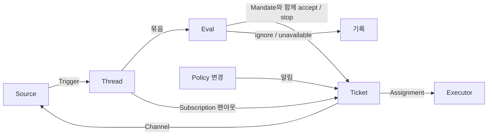

# 001 도메인 모델

이 문서는 dsh-superagent의 개념과 각 개념이 지키는 규칙에 이름을 붙인다. 코드, 에이전트가 부르는 도구, 패널, 다른 문서는 이 용어만 쓴다. [000 철학](000-philosophy.md)에 따라 모델에는 작업에 필요한 개념만 두고, 업무상 필요는 그중 하나의 속성이 된다.

## 흐름

작업은 Trigger에서 Eval을 거쳐 실행으로 간다. Source가 Trigger를 만든다. Trigger는 자기 Thread에 구독된 Ticket으로 맥락으로서 팬아웃된다. 이렇게 Ticket에 닿은 사람의 메시지는 그 Ticket에 남는다. 나머지 Trigger는 모두 Eval로 들어가고, Eval은 그것이 새 작업을 요청하는지 판단한다. Eval이 accept하면 Mandate를 붙여 Ticket을 만든다. Assignment가 Ticket을 Executor에게 넘기고, 결과는 Channel을 거쳐 Source로 돌아간다.

## 개념

Source, Thread, Eval, Mandate, Subscription이 핵심 도메인이고 나머지는 이들을 받친다.

| 개념 | 정의 | 지키는 규칙 | 있는 이유 |
| --- | --- | --- | --- |
| Source | 이벤트의 흐름. Source 종류(kind)는 재사용 가능한 구현이고, Source 인스턴스는 한 종류의 설정 하나다. 돌지 여부와 무엇을 들을지를 정한다 | 자기 읽기 위치와 자기 봇 신원을 갖는다. 시간이 지나야만 성립하는 조건을 포함해 무엇이 이벤트인지 정의한다. 봇 자신의 메시지와 듣는 범위 밖의 Trigger는 도메인에 들어오기 전에 버린다. 각 Trigger를 그것이 속한 Thread와 답할 Channel 주소로 옮긴다 | 재시작이 이벤트를 다시 재생하면 안 된다 |
| Trigger | Source 고유의 메타데이터(행위자 등)를 지닌 불변 이벤트 하나 | Thread 하나 이상에 속한다. 같은 Trigger를 두 번 accept해도 Ticket은 하나만 생긴다 | 감사와 멱등성의 단위 |
| Thread | 시간 순서로 놓인 Trigger. 어떤 Trigger가 한 Thread를 이루는지는 Source가 정한다 | 한 번에 Eval 하나만 돈다. Ticket을 여럿 가질 수 있다. 자기 Subscription, 도는 Eval, Decision 이력을 갖는다 | Eval에 일관된 시야와 맥락을 준다 |
| Correlation | 한 Trigger가 속한 Thread들 사이의 관계 | 맥락을 더할 뿐 라우팅하지 않는다 | Eval이 관련 증거를 따라가게 한다 |
| Channel | Thread의 쓰기 쪽. 주소는 Source가 정한다 | Thread는 Channel을 여럿 가질 수 있고, Ticket은 Channel 집합을 갖는다 | 확인 응답, 답글, pull request, 해결된 리뷰가 모두 쓰기다 |
| Policy | 버전이 붙은 판정 규칙과 각 Source의 몫. 그 Source로 누가 작업을 일으킬 수 있는지(그 Source 고유의 신원으로), 목록을 어떻게 동기화하는지, 어느 봇이 후보를 만들 수 있는지를 담는다 | Policy 버전은 규칙, accept 모드, Source 몫을 덮는다. 살아 있는 Ticket에 걸리는 변경(그 Ticket이 accept된 규칙의 변경 등)은 그 Assignment로 전달되고 Mandate를 철회하지 않는다. 서로 다른 Source의 신원은 절대 서로 대응시키지 않는다 | 규칙이 바뀌면 돌고 있는 Eval을 버려야 한다 |
| Eval | Trigger 묶음에 대한 판단. 게이트와 판정 두 층으로 이뤄진다 | 입력은 Trigger 묶음, Thread 스냅샷, 끝난 것을 포함해 Thread의 모든 Ticket, 현재 Policy다. 출력은 Decision이다. 상태를 갖지 않는다 | 새 작업을 시작할지, 이어 갈지, 멈출지 정한다 |
| Mandate | accept가 주는 것. Policy 버전, 범위, 강도, 맞은 규칙, 그 Source에서의 보낸 사람 신원, Source가 Trigger를 받은 방식을 담는다 | 불변이다. 범위가 넓어지면 새 Ticket이 된다. Ticket이 끝나도 Mandate는 끝나지 않는다. 사람의 stop만 그것을 거두고, 더는 그것을 허락하지 않는 Policy가 그것을 철회한다. 끝난 Ticket이 재개되기 전에 현재 Policy로 다시 검증한다 | 왜 그 일을 해도 되는지, 어디까지 해도 되는지 밝힌다 |
| Ticket | 권한을 받은 작업 단위 | Eval만 만든다. 자기 Mandate를 가리키고, Channel과 Input을 갖는다. open → ended로 가고, 자기 Thread 하나에 온 사람의 메시지가 재개하면 다시 open으로 돌아간다. 사람이 멈춘 경우는 예외다. Executor의 상태를 따르지 않고 자기 상태를 스스로 정의한다 | 실행과 그 보고를 맡는다 |
| Assignment | Ticket과 Executor 인스턴스 하나의 결합 | Ticket은 시간에 따라 여럿을 갖는다. Ticket과 따로 pending → running → ended로 간다. Executor 쪽에서 Ticket을 끝낼 수 있는 것은 마지막 보고뿐이다 | Executor는 도메인 밖에 있지만 누가 실행하는지는 도메인 안에 있어야 한다 |
| Subscription | Ticket과 Thread 사이의 다대다 관계. Thread가 갖는다 | 맞는 Trigger는 보낸 사람을 따지지 않고 구독 중인 살아 있는 Ticket 모두에 팬아웃된다. 이렇게 Ticket에 닿은 사람의 메시지는 Eval을 거치지 않는다. Executor가 맥락용으로 따라가는 Thread도 같은 방식으로 Ticket에 닿지만 권한을 빌려주지 않고 재개하지도 않는다. 끝난 Ticket은 닫히거나 병합된 pull request의 것까지 포함해 Subscription을 유지한다. 사람의 메시지는 Eval이나 Decision 없이 같은 Mandate로 그것을 재개한다. 봇과 CI의 메시지는 닿지 않는다. 재개할 때 Executor가 Thread를 다시 읽기 때문이다. 사람이 멈춘 Ticket은 아무것도 받지 않는다. 메인 Session은 메시지가 기존 Ticket을 명시적으로 가리킬 때만 Thread를 그 Ticket에 붙인다. 사람은 한 Thread의 Subscription을 모두 끊을 수 있다. Executor는 관련 없다고 판단한 Thread에 대한 자기 Ticket의 Subscription만 끊을 수 있다. 다만 Ticket이 시작된 Thread와, pull request의 Thread처럼 Source가 따라가게 한 Thread는 끊을 수 없다 | 아무도 에이전트를 다시 부르지 않아도 뒤이은 논의가 Executor에 닿는다 |

사람은 도메인 개념이 아니다. Trigger는 Source가 준 그대로 행위자의 식별자를 싣는다. 허용 목록은 Policy에서 Source가 맡는 몫이고 그 Source의 신원으로 적는다. 한 사람이 여러 Source에 계정을 가졌다는 사실은 에이전트가 필요할 때 읽는 프롬프트 글이다.

Session과 디렉터리를 거느린 Executor는 도메인 밖에 있고 Assignment로 연결된다.

집합체(aggregate)는 이렇다. Source는 읽기 위치를 갖는다. Thread는 Subscription, 도는 Eval, Decision 이력을 갖는다. Eval은 순차로 돌고, 도는 동안 도착한 Trigger는 다음 묶음에 합친다. Ticket은 Assignment, Channel, Input을 갖고, Decision은 id로 가리킨다.

## 버린 개념

| 버린 것 | 이유 |
| --- | --- |
| Principal이나 Membership 같은 엔티티, Source 사이의 신원 대응 | 사람은 Trigger 메타데이터다. 허용 목록은 Policy에서 Source가 맡는 몫이다. Source 사이의 대응은 프롬프트 글이다 |
| Eval이 지연 Trigger를 스스로 예약하기 | 기다려야 하는 조건은 평범한 Source다. 그래서 Eval은 Source에 거꾸로 의존하지 않는다 |
| 대기나 철회 같은 Eval 상태 | 대기는 Source의 몫이다. 시간이 다 된 Eval은 Trigger를 다시 줄 세우거나 `unavailable`로 끝난다 |
| Thread당 살아 있는 Ticket은 최대 하나 | 한 Thread가 독립된 작업 여럿을 실을 수 있다. 판정이 Ticket 목록을 보고 중복을 피한다 |
| "Ticket에 덧붙이기" Decision | 덧붙이기는 Subscription 팬아웃이고 Eval이 필요 없다 |
| Subscription의 입장 검사 | Subscription은 Thread 전체를 덮는다. 권한과 맥락은 Mandate가 가른다 |
| 라우팅하는 Correlation | 라우팅은 Subscription이 한다. Correlation은 맥락만 더한다 |
| DSH Session을 따르는 Ticket 상태 | Ticket은 넘겨지거나, 재개되거나, 여러 Executor가 돌릴 수 있다. 그래서 자기 상태를 스스로 정의한다 |
| 사람이 멈추라고 했다고 Executor가 선언하기 | 끝남의 강도는 Eval만 정한다 |
| Policy 변경 때 돌고 있는 Ticket 취소 | 취소하면 반쯤 끝난 작업이 남는다. 대신 변경을 기록하고 전달한다 |
| Executor Session이 실패하거나 막혔을 때 모든 도구 잠그기 | Session에서 직접 일하는 사람과 복구 뒤 보고까지 거부하게 된다. 자동 입력을 멈추는 것으로 충분하다 |
| 보고의 자유 글에서 "사람을 기다림"을 추론하기 | 분류에는 구조화된 사실이 필요하다. Executor는 구조화된 필드로 묻는다 |

## 재사용할 수 있는 것

위의 개념과 규칙은 재사용할 수 있다. Source 구현, Policy 내용, Executor, Channel 구현은 배포에 속한다. 각 Source는 메시지, 채팅, 알림처럼 내부에서 자기 말을 쓰고 그것을 Trigger로 옮긴다.

| 부분 | 이 저장소에서 |
| --- | --- |
| Source | Feishu: 실시간 이벤트, 이력 복구, 구독한 토픽 폴링. GitHub: 알림, 구독한 Issue와 pull request, CI 변화, 병합되거나 닫힌 pull request, 그리고 켜 둔 곳에서는 저장소의 모든 새 Issue, pull request, 댓글과 기본 브랜치의 CI |
| Policy | 판정 규칙, 그리고 각 Source의 허용 목록, 동기화, 봇 목록, 입장 표 |
| Executor | Ticket마다 DSH Executor Session 하나와 디렉터리 하나. Executor와 Source가 등록한 변수를 쓰는 실행 환경에서 돈다 |
| Channel | Feishu 토픽 답글, GitHub 댓글과 리뷰 스레드 답글 |

## 용어집

이 문서와 뒤 문서가 쓰는 용어의 참고 목록이며 중국어 이름을 함께 적는다. 위에서 소개하지 않은 용어는 뒤 문서가 설명한다. 패널은 한 번에 한 언어로 보이고, (?) 버튼이 두 언어를 함께 담은 이 용어집을 연다. 에이전트가 GitHub와 Feishu에서 사람에게 보내는 메시지는 이 용어가 아니라 쉬운 말을 쓴다.

| 용어 | 中文 | 뜻 |
| --- | --- | --- |
| Agent | 智能体 | dsh-superagent가 돌리는 자동화된 팀원. GitHub 계정과 Feishu 봇 같은 신원으로 Source에서 움직인다 |
| Main Session | 主 Session | Trigger를 판정하고, Ticket을 accept해 배정하고, 답하는 DSH Session. 코드와 프롬프트에서는 `orchestrator` |
| Executor Session | 执行器 Session | Executor가 Ticket 하나를 위해 돌리는 DSH Session. 코드와 프롬프트에서는 `worker` |
| Source | 来源 | 이벤트의 흐름. 플러그인이 제공하는 종류와 인스턴스 설정 하나로 이뤄진다 |
| Trigger | 触发 | Source에서 온 불변 이벤트 하나 |
| Thread | 线程 | 시간 순서로 놓인 Trigger. 그 안에서 Eval이 한 번에 하나씩 도는 단위 |
| Correlation | 关联 | Trigger를 공유하는 Thread들 사이의 관계. 맥락만 더한다 |
| Channel | 渠道 | Thread의 쓰기 쪽 |
| Policy | 策略 | 작업 accept에 쓰는 버전 붙은 규칙과, 거기서 누가 일을 부탁할 수 있는지 같은 각 Source의 몫 |
| Policy version | 策略版本 | 규칙, Source 몫, accept 모드의 한 조합을 가리키는 식별자. 모든 Mandate가 이것을 기록한다 |
| Eval | 评估 | Trigger 묶음을 Decision으로 바꾸는 과정 |
| Gate | 准入 | Eval의 결정론적 첫 층. 누가 어떤 강도로 작업을 일으킬 수 있는지 본다 |
| Assessment | 研判 | Eval 중 모델이 내리는 판단 |
| Decision | 决定 | Eval의 결과 |
| Mandate | 授权 | accept가 주는 것. 강도, 범위, 기댄 Policy 버전 |
| Ticket | 工单 | 권한을 받은 작업 단위 |
| Assignment | 派工 | Ticket과 Executor 인스턴스 하나의 결합 |
| Subscription | 订阅 | Ticket과 Thread 사이의 관계 |
| Fan-out | 扇出 | 구독한 Thread의 Trigger를 맥락으로 Ticket에 전달하기 |
| Executor | 执行器 | Assignment를 돌리는 포트. Ticket마다 Executor Session 하나와 디렉터리 하나 |
| Execution environment | 执行环境 | Executor Session과 prepare 명령이 도는 곳. Executor와 Source가 등록한 변수로, 각각 키, 값, 설명을 갖는다 |
| Report | 报告 | Assignment가 자기 Ticket에 보고하는 상태 |
| Attention | 待人工决定 | 사람의 답을 기다리는 Ticket의 질문 |
| Disposition | 去向 | Trigger가 걸러졌는지, 판정됐는지, 팬아웃됐는지의 기록 |
| Input | 输入 | Ticket에 전달된 맥락. 팬아웃된 Trigger, Policy 변경, 재개, 글 |
| Scope | 范围 | Mandate가 허락하는 작업 |
| Strength | 强度 | Mandate나 Eval의 근거가 얼마나 강한지 |

| 묶음 | 값 |
| --- | --- |
| Decision | accept 接单 · stop 停止 · ignore 忽略 · unavailable 未完成 |
| Strength | explicit 明确 · inferred 推断 |
| Assignment | pending 待启动 · running 执行中 · ended 已结束 |
| Report | progress 进展 · waiting 等待 · ready 就绪 · blocked 受阻 · failed 失败 · dropped 无需处理 |
