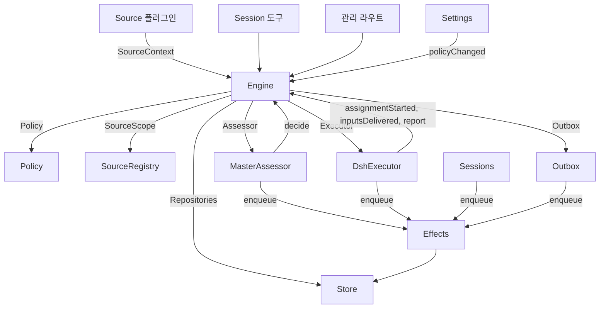

# 007 아키텍처

구현을 다루는 개발자 안내서다. [001 Domain model](001-domain.md)부터 [006 Deployment](006-deployment.md)까지의 개념을 클래스, 인터페이스, 파일에 대응시킨다. 런타임과 Engine부터 읽고, 모듈 표와 테스트 표는 코드 색인으로 쓴다.

## 핵심 클래스와 글루

핵심 클래스는 작은 인터페이스 뒤에서 도메인 개념과 외부 경계를 맡는다. 글루는 도구 인자, HTTP 요청, Source 페이로드, DeepSeek Harness 이벤트를 이 클래스들의 호출로 옮기고, 결과를 카드, 뷰, 메시지로 바꾼다.

`Runtime`(`src/app/runtime.ts`)은 애플리케이션을 조립하고 의존성을 공급하며 시작과 종료를 맡는다. `Engine`은 자기 내부 부품을 직접 만든다. Executor와 Assessor가 Engine을 다시 호출하므로, Runtime은 순환 순서로 생성하게 하는 대신 getter를 넘긴다.

### Runtime

`Runtime`은 조립 루트이고 도메인 규칙을 담지 않는다. 생성자는 상태 디렉터리를 잠그고, Store를 열고, 각 컴포넌트를 만든다. 생성에 실패하면 Store를 닫고 잠금을 푼다.

시작 단계는 관리 라우트를 등록하고 Setup을 돌린다. setup이 끝나면 Session 훅과 Executor 훅을 설치하고, 메인 Session이 있는지 확인하고, Policy 동기화를 시작하고, 중단된 Assignment를 재개하고, 패스와 effect를 시작한다. `ready`가 시작 완료를 표시한다.

종료 단계는 턴을 취소하고, 패스, effect, 에이전트를 기다리고, 프로세스 환경을 복원하고, Store를 닫고 잠금을 푼다. Source 플러그인은 좁은 `SourceHost` 인터페이스로 Runtime을 `orchestrator` 서비스로 주입받는다.

| 부품 | 모듈 | 하는 일 |
| --- | --- | --- |
| Setup | `src/app/setup.ts` | 워커 셸이 실행하는 방식대로 CLI를 탐지해 저장소와 계정을 확정하고, 워커의 환경과 명령 shim을 쓰고 적용하며, setup 문제를 보관한다. Settings는 바뀐 계정을 이것으로 확인하고, 재시작도 이것을 거치며 재시작하면 setup이 다시 돈다 |
| Passes | `src/app/passes.ts` | 한 번에 패스 하나를 2초마다, 그리고 명령이 요청할 때마다 돌린다. 기한이 된 effect를 처리한 뒤 `Engine.evaluateDue`를 부른다. Source의 Trigger는 이것을 거쳐 Engine에 닿는다 |
| Outbox | `src/app/outbox.ts` | Engine의 `Outbox` 포트이며 receipt를 쓰는 유일한 주체다. `send`는 메시지의 receipt 보관과 `reply` effect 등록을 한 트랜잭션에서 한다. effect 핸들러는 `SourceRegistry.send`로 메시지를 보낸다. Source가 꺼져 있으면 메시지는 기다리고, 대화가 사라졌거나 수신하지 않는 대화면 버린다 |
| Notices | `src/app/notices.ts` | 도메인 이벤트와 워커 활동을 메인 Session 메시지로 바꾼다. `eventNotice`는 도메인 알림을 다룬다. `reportRelay`는 질문을 즉시 전달하고, 평범한 진행 상황은 해당 Ticket에 남기고, 나머지 Report는 전달한다. `followupRelay`는 사람의 후속 메시지를 소유한 Ticket을 알려 준다. 턴 도중 도착한 relay는 DeepSeek Harness inbox를 거쳐 다음 단계에서 한꺼번에 전달된다 |

### Engine

`Engine`(`src/core/engine.ts`)은 Trigger, Thread, Decision, Ticket, Assignment를 쓰는 유일한 주체다. `src/core/ports.ts`의 포트 `Repositories`, 현재 Policy getter, `SourceScope`, `Assessor`, `Executor`, `Outbox`를 받는다. 선택 의존성은 `prepareTicket`, `now`, `emit`이다.

Engine 메서드는 모두 동기다. 각 명령은 자기 aggregate를 한 트랜잭션에서 바꾼다. `evaluateDue`는 바꾸는 Eval이나 Ticket마다 트랜잭션을 따로 쓴다. 포트는 외부 작업을 트랜잭션 안에서 등록하고, 어댑터가 커밋 뒤에 실행한다. 잘못된 요청은 `UserError`를 던진다.

Engine은 진입점 하나를 드러내고 내부 부품 다섯에 위임한다. 각 명령의 트랜잭션은 Engine이 소유한다. `attach`, `evaluateDue`, `policyChanged`처럼 여러 부품에 걸친 명령은 부품을 차례로 호출한다.

각 부품은 옵션과 공용 읽기를 제공하는 `EnginePart`(`src/core/part.ts`)를 확장한다. 부품 사이 의존성은 한 방향으로만 흐른다.

| 부품 | 책임 | 의존 대상 |
| --- | --- | --- |
| `Intake` | Source의 Trigger를 처리한다. 처분과 함께 한 번 저장하고, 그 Thread와 correlation에 기록하고, 구독한 Ticket에 fan-out한다. Ticket에 닿은 사람의 메시지가 아니면 primary Thread에서 Eval 대기열에 넣는다 | Tickets |
| `Evals` | Thread의 Eval을 다룬다. 배치 묶기, gate의 강도와 actor와 basis 및 그것을 준 Trigger(`primary`), 후보 전달 시점부터 세는 기한과 일시 중지에 따른 기한 이동, 만료된 Eval의 재대기, 후보, replay와 hand-back, Policy 변경 시 재대기, 그리고 각 Eval을 끝내는 Decision(accept, stop, ignore, unavailable)이다 | Tickets |
| `Tickets` | Ticket 수명 주기를 다룬다. Mandate, Subscription, 첫 Assignment와 함께 accept에서 Ticket을 만드는 일, Ticket이 따르는 Thread와 그 닫힘(`followsDone`), 첨부된 Thread와 맥락용으로 따르는 Thread, Input과 note, 재개와 재개가 거부하는 메시지, retry, restart, stop과 종료, Ticket이 버리는 Subscription, Policy 변경이 영향을 주는 Ticket에 보내는 알림이다 | Replies |
| `Assignments` | Executor와 워커가 보고하는 사실을 다룬다. Assignment 시작, Input 도달 또는 실패, 재시작으로 인한 중단, 사람에게 묻는 질문을 담은 워커 Report다 | Tickets, Replies |
| `Replies` | `Outbox`를 거치는 Channel 쓰기다. acknowledgement, answer, result, attention 메시지를 각각 허용하는 규칙에 따라 보낸다 | 없음 |

명령은 `stopTicket`처럼 명령형 이름을 쓴다. 어댑터가 보고하는 사실은 `assignmentStarted`처럼 과거형 이름을 쓴다. 조회 `candidate`는 명사를 쓴다.

호출자는 자기 역할에 맞는 Engine의 `Pick`만 받는다. `EngineForSources`, `EngineForMainSession`, `EngineForPeople`, `EngineForSettings`, `EngineForExecutor`다.

| 역할 | 메서드 | 효과 |
| --- | --- | --- |
| Sources | `receive(trigger)` | Trigger를 한 번 저장하고 `stored`, `duplicate`, 또는 받는 Source가 없으면 `filtered`로 답한다. Trigger의 Thread를 구독한 Ticket에 fan-out한다. 처리가 일시 중지된 때가 아니면 사람의 메시지는 끝난 Ticket을 즉시 재개한다. primary Thread에서 Eval 대기열에 넣되, Ticket에 닿은 사람의 메시지는 그 Ticket의 몫으로 남긴다 |
| Sources | `bindThread(ticketId, thread, own)` | 열린 Ticket이 pull request의 Thread처럼 Source의 Thread 하나를 따르게 한다. Ticket이 그 Thread를 열었으면 `own`이다. 닫힌 Thread를 다시 묶으면 다시 열린다. Ticket을 끝내는 것은 `ready` Report가 아니라 Thread의 닫힘이다 |
| Sources | `threadClosed(thread, outcome, at)` | Thread가 닫혔다. 그 Thread를 따르는 열린 Ticket마다 닫힘을 기록하고, 따르는 Thread를 다 마치면(`followsDone`) 끝낸다. 다 마쳤다는 것은 Ticket이 연 Thread 중 열린 것이 없거나, 연 Thread가 없으면 따르는 Thread가 모두 닫혔다는 뜻이다. 그 닫힘 중 가장 늦은 것을 따라 `merged`나 `closed`로 끝난다. 다만 닫힘 뒤에 재개한 작업이 아직 `ready`를 보고하지 않았거나, 마지막 `progress` 외 Report 또는 마지막 턴의 끝 이후에 Executor가 결정하는 사람의 후속 메시지를 acknowledge나 answer로 맡았다면 끝내지 않는다. 그런 경우 `dropped` Report가 오면 그 닫힘처럼 끝낸다 |
| Main Session | `candidate(triggerId)` | Trigger를 담은 Eval을 assessor가 보는 모습으로 돌려준다 |
| Main Session | `candidateDelivered(evalId)` | Eval의 후보가 메인 Session에 닿았다. 기한을 지금부터 센다 |
| Main Session | `decide(triggerId, outcome)` | Eval Decision을 기록하거나, 명시적 요청이면 직접 Decision을 기록한다. Accept는 Ticket, Mandate, Assignment, Subscription, acknowledgement를 원자적으로 만든다. 카드에서 무시한 추론 후보는 주어진 사유 앞에 `ignoredFromCard`를 기록한다. `followupOwners`가 아직 사람의 후속 메시지를 소유하는 동안에는 stop만 허용한다 |
| Main Session | `attach(ticketId, triggerId, note?)` | Trigger를 그것이 가리키는 Ticket으로 보낸다. 그 Ticket의 Executor가 후속 메시지로 결정한다. Trigger를 담은 Eval을 끝내고, 그 Eval의 다른 Trigger는 새 Eval을 기다린다. 처리가 일시 중지된 때가 아니면 끝난 Ticket은 자기 Mandate로 즉시 재개한다. Executor가 아직 결정하는 후속 메시지와, 그것을 돌려준 Ticket으로 다시 보내는 메시지는 거부한다 |
| Main Session | `requestStatus(ticketId)` | 기다리는 Executor Session에 상태를 묻고, 물었는지를 답한다 |
| Main Session | `note(ticketId, text)` | 다른 작업에서 얻은 사실을 텍스트 Input으로 Ticket의 Executor에 준다. 아무 권한도 주지 않는다 |
| Main Session, Executor | `reply(request)` | 목적이 가리키는 Channel(`acknowledgement`, `answer`, `result`, `attention`)로 보낼 메시지를 대기열에 넣는다 |
| People | `stopTicket(ticketId, reason?)` | 사람의 stop이며 Mandate를 거둔다 |
| People | `retryTicket(ticketId)` | `failed`나 `blocked` Report 뒤 사람을 기다리는 Ticket, 또는 Input 전달이 실패한 Ticket(`canRetry`)의 멈춘 Assignment를 끝내고 새 Assignment를 시작한다 |
| People | `reevaluate(triggerId)` | 저장된 Trigger를 새 Eval 대기열에 넣는다 |
| People | `unsubscribe(thread)` | Thread의 Subscription을 모두 버리고, 그 Thread를 따르던 Ticket은 더는 따르지 않는다. 각 Ticket은 거기서 받은 후속 메시지를 계속 결정한다 |
| People | `dismiss(decisionId)` | `unavailable` Decision이 보여 주는 문제를 닫고, Decision이 이를 기록한다 |
| Executor | `assignmentStarted(ticketId, assignmentId)` | Assignment가 돈다. 기다리던 Input을 내보낸다 |
| Executor | `inputsDelivered(ticketId, assignmentId, inputIds)` | Input이 Assignment의 Executor Session에 닿았고, 각각 받아 갈 단계를 기다린다 |
| Executor | `inputsRead(ticketId, inputIds)` | Executor Session이 이 Input을 담은 메시지를 자기 기록(`user/message` Session 이벤트)으로 가져갔고, 모델은 거기서 그것을 읽는다. 메시지를 가져갔다가 그 전에 취소되거나 실패한 단계는 세지 않는다. 각 Input은 뒤에 Report나 턴의 끝이 오면 읽은 것으로 치며 재시작 뒤에도 마찬가지다. Ticket이 끝나도 이 기록은 풀리지 않는다. 읽음 기록 이전에 전달된 Input은 전달 뒤에 Report나 턴의 끝이 왔으면 읽은 것으로 친다 |
| Executor | `turnEnded(ticketId, assignmentId)` | Executor Session의 턴이 끝났다. Report 뒤에도, 백그라운드에서 도는 것이 없거나 사람에게 넘길 때 호출된다. 단계가 그 전에 가져간 것은 읽은 것이다(`inputsRead`) |
| Executor | `deliveryFailed(ticketId, assignmentId, error)` | Input 전달이 실패했다. 전달이 성공하거나, 새 Assignment가 시작되거나, Ticket이 끝날 때까지 Ticket에 표시한다 |
| Executor | `report(ticketId, report)` | Report와 사람에게 묻는 질문을 기록한다. `dropped`는 Ticket을 끝낸다. `ready`는 Thread를 따르지 않는 Ticket을 완료하고, 따르는 Thread를 다 마친 Ticket은 그 Thread가 끝난 대로 끝낸다 |
| Executor | `markUnrelated(ticketId, thread, reason)` | 관련 없다고 판단한 첨부 Thread에서 그 Ticket의 Subscription만 버리고, 거기서 Ticket이 결정하던 후속 메시지를 사유와 함께 돌려준다 |
| Executor | `followForContext(ticketId, thread)` | 열린 Ticket을 맥락용으로 관련 Thread에 구독시킨다. 그 메시지는 Ticket에 닿지만 후속 메시지 강도를 주지 않고 Ticket을 재개하지도 않는다 |
| Executor | `handback(ticketId, triggerId, reason)` | Ticket이 자기에게 닿은 Trigger를 후보가 담을 사유와 함께 돌려준다고 기록한다. 이 Ticket이 결정하던 것이고 다른 Ticket이 결정하지 않으면 새 Eval 대기열에 넣는다. 넣었는지를 답한다. Ticket은 각 Trigger를 한 번만 돌려주고 Subscription은 유지한다 |
| Executor | `assignmentInterrupted(ticketId, assignmentId)` | 호스트가 멈출 때 Assignment가 돌고 있었다. 작업 도중 중단됐거나 마지막 Report 뒤 Input을 받은 Assignment는 retry처럼 복구 노트와, 전달됐지만 Executor Session이 가져가지 않은 Input을 들고 다시 시작한다. 그 뒤로 보고한 Assignment는 Session을 유지한다. DshExecutor는 시작 시(`resume`) 가장 오래된 Ticket부터 각각을 보고하고, 기다리는 launch를 다시 대기열에 넣는다 |
| Passes | `evaluateDue()` | 처리가 일시 중지된 때가 아니면 다음을 한다. 대기 중인 Trigger가 있는 Thread의 Eval을 Thread마다 하나씩, 그동안 쌓인 Trigger를 한 배치로 묶어 시작한다. 기한이 지난 Eval의 Trigger는 연속 두 번까지 다시 대기열에 넣고, 세 번째에는 `unavailable`로 기록한다. 일시 중지 중 사람의 메시지가 닿은 끝난 Ticket은 Mandate가 아직 유효하면 재개한다. 후보가 메인 Session에 닿지 않은 Eval은 만료되지 않는다. 처리가 일시 중지된 동안 Eval은 만료되지 않고, 재개되면 각 기한이 일시 중지 시간만큼 늦춰진다 |
| Settings | `policyChanged(from, to, effects)` | 변경이 영향을 주는 살아 있는 Ticket마다 어떻게 영향을 주는지 알린다(`src/policy.ts`의 `policyEffects`). 수락 근거였던 규칙이 바뀌었거나 더는 적용되지 않는 경우, 요청자가 더는 작업을 시작할 수 없는 경우, 선제 작업을 더는 받지 않는 경우다. 진행 중인 Eval은 새 버전으로 다시 시작한다 |

Engine은 배치, 권한 부여, fan-out, 재개, attention 수명 주기 규칙을 내부에 숨긴다. 공용 술어 몇 개가 이 규칙들을 일관되게 만든다.

- `waitsForPerson`(`src/core/model.ts`): 최신 Assignment가 `blocked`나 `failed`를 보고했고 그 뒤로 사람의 메시지가 오지 않았다. 이 값이 참인 동안 자동 Input과 실패한 launch는 보류된다.
- `followupOwners`: 자기 Thread에서 받은 사람의 후속 메시지를 아직 책임지는 Ticket이다. Ticket은 살아 있거나, 사람의 stop 없이 끝나 재개를 기다릴 수 있다. 메시지를 돌려주면 그 소유가 끝난다.
- `settled`: Decision이 요청을 해결했다. stop, unavailable, routed, refused-stop Decision은 세지 않는다.
- `ticketStage`(`src/core/stage.ts`): [003 Execution](003-execution.md)의 단계 표를 구현한다.

Ticket이 끝나면 읽지 않은 후속 메시지는 Eval로 돌아간다. 다른 Ticket이 아직 소유하거나 다른 처분이 해결한 메시지는 예외다. acknowledge, answer, hand-back한 메시지는 빠진다. acknowledgement 처분이 없는 예전 기록은 outbox receipt가 그 사실을 알려 준다. 최종 Report는 Assignment가 시작될 때 기다리던 메시지도 덮는다. Assignment를 재개시킨 메시지도 포함한다. Ticket을 멈춘 메시지는 자동으로 다시 평가하지 않는다.

변경 뒤 Engine은 `src/core/ports.ts`의 `DomainEvents`에서 이벤트 하나를 내보낸다.

`trigger.received`, `eval.started`, `decision.recorded`, `ticket.created`, `ticket.resumed`, `ticket.ended`, `assignment.started`, `assignment.ended`, `thread.subscribed`, `thread.unsubscribed`, `trigger.requeued`, `policy.changed` 중 하나다.

Runtime은 `ticket.ended`, `trigger.requeued`, `thread.unsubscribed`를 알림으로 바꾼다. Ticket에 전달된 사람의 `trigger.received`는 후속 메시지 relay가 된다. `pullEndNotices`는 Ticket이 merged나 closed로 끝나면 고정 id로 채팅 알림 하나를 보낸다. 나머지 이벤트는 지금 소비자가 없다.

### Model

`src/core/model.ts`는 도메인 타입을, `src/core/stage.ts`는 Ticket 단계를 담는다. Decision은 이유를 `reason`에 `Reason`(`src/core/reasons.ts`) 목록으로 기록한다. 각 항목은 `code`와 그 `values`, 배치의 Trigger 하나에 해당하면 그 `triggerId`를 가진다.

`timeout`, `policyChanged`, `routed`, `startedTicket` 같은 core의 코드는 `REASONS`이며, 에이전트가 `reasonText`로 읽는 영어 문구를 함께 가진다. gate나 Source scope는 `not_a_member`처럼 자기 코드를 준다. `said`는 assessor나 사람이 쓴 말을 담는다. 패널은 각 코드를 `reason.<code>`로 문구화하고, Source가 걸러 낸 Trigger도 같은 방식으로 Source의 코드를 기록한다.

Ticket은 각 사실을 한 번만 보관한다. `ended`가 없는 동안 열려 있으며, `ended`는 언제, 누가, 왜, 어떤 결과로 끝났는지 기록한다. 마지막으로 한 말은 최신 Assignment Report(`latestReport`)다. Executor Session의 이름은 Ticket에서 따온다(`src/executor/dsh.ts`의 `workerSessionId`).

필드는 타입이 정해져 있다. `origin`은 Eval 배치에 강도를 준 허용 가능 Trigger와 배치 자체(`triggerId`, `triggerIds`)다. `execution`은 Executor가 고른 것(`name`, `directory`, `assignment`)이다. `delivery`는 마지막으로 실패한 Input 전달(`error`, `at`)이며, 전달이 성공하거나 새 Assignment가 시작되거나 Ticket이 끝날 때까지 남는다. `follows`는 Source가 Ticket에 따르게 한 Thread이며 각각 `{thread, own, closed?}`다. Ticket이 열었으면 `own`이고, 닫히면 `closed`에 `at`과 `outcome`이 들어간다. `follows`는 Tickets만 쓴다. GitHub Source는 `pullsOf`와 `pullOf`(`src/sources/github-pull.ts`)로 자기 pull request를 읽는다.

Trigger를 담은 Input은 사람이 썼는지 기록하고, `waitsForPerson`이 그것을 읽는다. Thread는 맥락용으로만 따르는 구독 Ticket을 `context`에 나열하고, 대기 중인 Trigger의 Eval이 연속으로 만료된 횟수를 `expired`에 센다. Evaluation은 `primary` Trigger와 후보가 `delivered`된 시각을 기록한다.

Trigger의 처분은 fan-out이나 첨부로 닿은 Ticket, 사람의 재대기, 사유와 함께 그것을 돌려준 각 Ticket, Executor가 acknowledge나 answer한 각 Ticket을 기록한다.

Mandate의 `basis`(`MandateBasis`)는 gate가 Trigger를 어떻게 받아들였는지 기록한다. 재검증은 받은 `source`, `scope`, `row`, 목록에 있는 `sender`, 일치한 `rules`, 그리고 `via`를 읽는다.

| `via` | 허용 근거 |
| --- | --- |
| `addressed` | 허용된 발신자가 에이전트를 불렀다 |
| `followup` | Ticket이 있는 Thread에 메시지가 왔다 |
| `admission` | admission 표의 칸이다. `observation`은 추론 후보를 뜻한다 |
| `bot` | 목록에 있는 bot이 추론 후보를 만들었다 |

Trigger와 Thread의 `meta`는 Source 소유다. core는 해석하지 않는다.

### Policy

`src/policy.ts`는 설정 스키마, 권한 부여, 평가 규칙을 정의한다. `settingsPolicy(settings, scope)`는 쓸 때마다 상태 없는 새 `Policy`를 돌려준다.

- `version`, `paused`, `evalTimeoutMs`는 현재 상태를 나타낸다.
- `gate(trigger, thread, tickets)`는 허용 강도와 근거를 돌려준다.
- `revalidate(mandate)`는 기존 Mandate가 아직 유효한지 확인한다.
- `admitsInferred(rules)`는 auto 모드에서 일치하는 규칙이 켜져 있을 때만 선제 수락을 허용한다.

`assessmentOutcome(assessment, settings, strength)`는 모델의 평가를 Engine 결과로 바꾼다. 켜진 규칙마다 판단, 정해진 방향, 일치하는 규칙, 의도의 증거를 요구한다. auto 모드가 아니면 추론 accept는 “would accept” 기록이 된다.

`policyEffects(tickets, old, now, scope)`는 변경이 어떤 열린 Ticket에 어떻게 영향을 주는지 가려낸다. `Engine.policyChanged`는 그 Ticket에만 알린다. `policyVersion`은 규칙, accept 모드, bot 목록을 포함한 Source의 Policy 부분을 해시한다.

### Store

`Store`(`src/app/store.ts`)는 SQLite 데이터베이스 하나를 소유한다. Runtime은 열기 전에 디렉터리 잠금을 얻어, 두 번째 프로세스가 같은 상태를 마이그레이션하거나 쓰지 못하게 한다.

인터페이스는 목적별로 묶인다.

- **도메인 저장소:** `atomic`, 그리고 `triggers`, `threads`, `tickets`, `decisions`다. 각각 `get`, `save`, 목록 조회를 가진다. 인덱스가 걸린 작업 집합은 `threads.active()`, `tickets.open()`, `tickets.active()`, `read.subscribedThreads`다.
- **읽기 조회:** `read`는 `threadTriggers`, `triggerStats`, `search`, `droppedReplies` 같은 메서드로 뷰, 도구, Source 폴링에 답한다. 이 메서드들은 쓰지 않는다.
- **Source 메타데이터:** `threads.describe`와 `threads.patchMeta`가 Source 소유 Thread 메타데이터를 갱신한다.
- **설정:** `settings`, `saveSettings`, `blockRevision`, `settingsHistory`다. 설정과 프롬프트는 번호가 붙은 `Versions`(`src/app/versions.ts`)를 쓴다.
- **Outbox receipt:** `replyStatus`와 `receipts`이며 Outbox만 쓴다. receipt 연산은 `get`, `waiting`, `behind`, `add`, `settle`, `withdraw`다. `behind`는 같은 Ticket과 대화의 이전 메시지가 실패 세 번 미만으로 기다리는지 확인한다. 거둬들인 메시지는 `channelGone`이나 `channelIgnored`로 정리된다. 읽기 조회는 실패하거나 버린 응답을 `failingReplies`, `droppedReplies`, `droppedSince`로 보여 준다.
- **타입이 있는 키-값 기록:** `KV`의 항목을 쓰는 `get`, `set`, `delete`, `keys`다.

`afterCommit`은 트랜잭션이 커밋된 뒤에만 동작을 실행하고, 롤백 뒤에는 실행하지 않는다. Runtime은 기록을 저장된 모양 그대로 읽는다. 스키마 11 마이그레이션이 지원하는 예전 기록을 시작 시 변환한다.

### Effects

`Effects`(`src/app/effects.ts`)는 지속되는 부수 효과 대기열이다. 명령은 트랜잭션 안에서 `enqueue(kind, key, payload)`를 부르고, 실행은 커밋 뒤에야 시작한다.

kind/key 쌍마다 행이 하나다. 기다리는 같은 key를 다시 넣으면 페이로드를 바꾸고 대기열 순서는 그대로 둔 채 즉시 기한이 된다. `handle(kind, run, options)`는 kind마다 핸들러 하나를 등록한다. 기한이 된 행을 오래된 것부터 동시 실행 한도까지 처리한다.

실패는 지수 백오프로 재시도한다. `Later`를 던지면 실패로 세지 않고 작업을 미룬다. 워커 슬롯이 없을 때가 그 예다. `start`는 setup 뒤 처리를 시작하고, `drain`은 종료 중 대기 행을 보존한 채 처리를 멈추며, `pending`/`idle`은 대기열 상태를 보여 준다.

| Kind | 핸들러 | 하는 일 | 동시 실행 | 재시도 |
| --- | --- | --- | --- | --- |
| `assessment` | MasterAssessor | Eval의 후보 카드를 메인 Session의 턴에 밀어 넣고 전달됐다고 Engine에 알린다. 이때 Eval의 기한이 시작된다 | 4, 일시 중지 중에는 0 | 2초부터 두 배씩 60초까지 |
| `launch` | DshExecutor | 대기 중인 Assignment를 띄운다. prepare 명령, Executor Session, assignment 메시지다 | 빈 워커 슬롯 수, 일시 중지 중에는 0 | 모델 제공자나 네트워크의 일시적 실패는 5초부터 두 배씩 300초까지 세 번 다시 돈다. 다른 실패와 prepare 명령 실패는 Ticket을 실패시킨다. 일시 중지나 꽉 찬 워커 슬롯으로 보류된 것은 5초 뒤 다시 시도한다 |
| `delivery` | DshExecutor | Ticket의 기다리는 Input을 실행 중인 Assignment에 순서대로 넘긴다 | 4, 일시 중지 중에는 0 | 2초부터 두 배씩 60초까지. 워커 슬롯을 기다리는 것은 2초 뒤 다시 시도한다 |
| `relay` | Sessions | 워커의 Report나 질문, 또는 사람의 후속 메시지를 메인 Session의 턴에 밀어 넣는다 | 1, 대기열 순서대로 | 2초부터 두 배씩 60초까지 |
| `notice` | Sessions | 메인 Session을 깨우지 않고 알림을 넣는다 | 1, 대기열 순서대로 | 2초부터 두 배씩 60초까지 |
| `reply` | Outbox | Channel로 갈 메시지를 Source로 보낸다. 같은 Ticket이 같은 대화에 보낸, 세 번 실패하지 않은 이전 메시지들 다음에 보낸다. 메시지를 거둬들이면 취소된다 | 1, 일시 중지 중에는 0 | 5초부터 두 배씩 300초까지. Source가 꺼져 있거나 이전 메시지 뒤에 있으면 5초 뒤 다시 시도한다 |

kind마다 자기 이름으로 health 항목이 있다. effect 하나가 연속 세 번 실패하면 오류를 보고한다. 단 `delivery`는 실패를 Ticket에 대신 표시한다. relay는 순서를 지키고 notice도 마찬가지다. 실패한 것이 같은 kind의 뒤 항목을 붙잡아 둔다.

### Sources

Source는 `src/sources/kind.ts`에 정의된 `SourceKind`로 호스트를 확장한다. kind는 정체, 제목, 설명, 설정 `schema`와 `fields`, 파생 `facts`, `health` 항목을 선언한다. 선택 동작으로 `scope`, `channel`(`allowed`, `send`, `link`), `threadContext`, `find`, `policy`, `environment`, `refreshLabels`가 있다.

`SourceRegistry`(`registry.ts`)는 등록된 kind와 저장된 인스턴스를 소유하고 Engine의 `SourceScope`를 구현한다. 등록할 때 `HealthBoard`에 health 항목을 점유한다. 중복 점유와 예약된 `sync:` 이름은 거부한다. SourceContext는 자기 등록이 점유한 항목으로만 쓰므로, 등록 해제 뒤의 보고는 아무 일도 하지 않는다.

레지스트리 설정 메서드로 `kind`, `instances`, `instance`, `validate`, `validatePolicy`, `policyPart`, `channelAllowed`, `declarations`, `environments`, `find`, `scope`가 있다. `find`는 검색을 지원하는 kind마다 묻는다.

범용 코드는 레지스트리를 거쳐 Source 동작에 접근한다. `send(message, commands)`는 kind의 Channel을 부르고 `sent`, `gone`, 또는 kind가 설치되지 않았으면 `waiting`을 돌려준다. `link`는 Channel 링크를 확정한다. `threadContext`는 kind의 reader를 그 설정과 묶고, reader가 없는 kind면 아무것도 돌려주지 않는다. 저장된 설정이 잘못되면 그 인스턴스를 끈다.

플러그인은 레지스트리와 `context(kind)`로 된 `SourceHost`를 받는다. kind 자체는 `src/app/source-context.ts`의 `sourceContextOf`가 만드는 더 좁은 `SourceContext`를 쓴다.

그 context는 배포와 명령, setup 준비 상태(`ready`, `configured`, `problem`), 설정, `receive`, `atomic`, 타입이 있는 `state`를 제공한다. Thread 읽기와 메타데이터 쓰기, Ticket 읽기와 binding/closure 명령, Trigger 읽기, Outbox를 거치는 `notify`, 선언한 health 항목용 `report`도 드러낸다.

### DshExecutor

`DshExecutor`(`src/executor/dsh.ts`)는 Ticket마다 Session 하나와 디렉터리 하나를 준다. `start`와 `deliver`는 `launch`와 `delivery` effect를 등록한다. `stop`은 `Store.afterCommit`으로 턴을 취소하므로, 롤백된 종료는 워커를 멈추지 않는다.

`prepare(ticket, outcome)`는 Engine의 `prepareTicket` 훅을 채운다. 짧은 이름, 디렉터리, `ticketExecution` assignment 텍스트다. `workerSessionId(ticket.id)`가 Session id를 만든다.

`WorkerSlots`는 launch나 쉬는 워커를 깨우는 delivery 전에 용량을 잡아 둔다. 사람의 메시지는 `maxWorkers`를 넘어 슬롯 하나를 더 쓸 수 있고, 깨우기가 launch보다 우선한다. `activeCount`는 패널 부하를 알려 준다.

제공자와 네트워크의 일시적 실패는 세 번 재시도한다. launch는 effect 백오프를 쓴다. 실패한 턴은 15초, 30초, 60초 뒤 계속하라는 메시지를 받는다. `inputMessage`는 각 Input을 현재 Ticket 상태로 렌더하고, `mandateInstructions`는 추론 작업에 일치한 규칙의 한도를 덧붙인다.

`install`은 Session 이벤트를 구독하고 `dispose`는 구독을 해제한다. 턴이 끝나면 보통 waiting을 보고한다. 준비 완료 뒤나 사람의 조치가 필요한 동안은 예외다. 오류는 failed로 보고한다. 시작 시 `resume`은 중단된 Assignment를 `assignmentInterrupted`로 보고하고, 사람을 기다리지 않는 대기 launch를 가장 오래된 Ticket부터 다시 대기열에 넣는다.

### MasterAssessor

`MasterAssessor`(`src/app/assessment.ts`)는 메인 Session이 선제 후보를 평가하게 한다. `request`는 assessment effect를 대기열에 넣고, `release`는 Eval이 끝나면 캐시된 상태를 버린다.

`context`, `read`, `decide` 메서드가 `orchestrator_eval`, `orchestrator_eval_read`, `orchestrator_eval_decide`에 답한다. `SourceRegistry.threadContext`로 범위가 정해진 Thread 맥락, 저장소 맥락, 결정 제출을 제공한다. context reader가 없는 kind는 Trigger와 배치만 준다.

`assessmentOutcome`은 모델의 답을 `Engine.decide`용으로 바꾼다. Evals는 추론 수락을 현재 Policy로 한 번 더 확인한다.

### Settings

`Settings`(`src/app/settings.ts`)는 리비전이 붙은 설정 블록을 읽고 쓴다. `current`와 `view`가 읽는다. `save(block, value, revision, origin)`는 저장을 검증한다. `pause(paused, origin)`는 별도 설정 `paused`를 바꾼다.

모든 저장은 출처 `panel`, `tool`, `sync` 중 하나를 밝힌다. 실행 환경이나 `SETUP_FIELDS`(`src/deployment.ts`)에 나열된 필드는 `panel`만 바꿀 수 있다.

Policy 버전이 바뀌면 `policyEffects`를 계산하고, 알림받은 Ticket을 기록하고, `Engine.policyChanged`를 부른다. `syncable`과 `sync(id)`는 Source의 Policy 부분을 새로 고친다. `refreshLabels(id)`는 표시 이름을 새로 고친다.

### Prompts

`Prompts`(`src/app/prompts.ts`)는 구성을 `Versions`로 저장한다. `current`, `version`, `history`가 읽고, `validate`, `preview`, `save(value, baseRevision, source)`가 확인하고 저장한다. `compose`와 `skills`가 Session 텍스트를 만든다.

`builtInParts`는 override 키, 역할, 기본 텍스트, 필수 템플릿 placeholder를 나열한다. 각 override는 팀의 `text`와 `base`를 저장한다. `base`는 원래 기본값의 `builtInBase` 키다. 저장할 때 그 기본값을 `KV.prompts.builtIn`에 보존한다. 그러면 `defaultChanged`가 바뀐 기본값과, 있으면 예전 텍스트, 그리고 제거된 부분을 보고한다.

검증은 빠진 base를 저장된 override에서 물려받고, 저장 데이터에 이미 있는 제거된 부분은 버리며, 빈 텍스트나 그 밖의 알 수 없는 키는 거부한다. 덕분에 저장 도구가 읽은 구성을 그대로 다시 저장할 수 있다. `environmentSection`과 `policySection`은 자기 키만 써서 템플릿 값을 한 번 치환한다. override가 없는 구성은 기본값을 쓴다.

### Sessions

`Sessions`(`src/app/sessions.ts`)는 두 역할의 DeepSeek Harness Session을 관리한다. `ensure`는 역할의 모델로 Session을 만든다. `install`은 에이전트 이벤트를 따라가며 관리 대상 Session에 프롬프트, 스킬, 도구를 등록한다.

`prompt`는 요청 id마다 한 번 전달한다. `relay`와 `notify`는 `relay`와 `notice` effect가 처리할 메인 Session 메시지를 대기열에 넣는다. 그 내용은 `src/app/notices.ts`가 정의한다. `delivery`는 메시지가 도착했는지 확인한다.

모델 요청마다 Session을 현재 프롬프트 리비전에 묶는다. 사용한 리비전은 지속 저장된다. `promptVersion`은 활성 리비전을 가리키고 `mayRead`는 워커가 볼 수 있는 버전을 제한한다. 등록 정보는 에이전트마다 맵 하나로 추적한다.

`status`와 `promptVersion`은 프롬프트 페이지에 답한다. 저장은 `Prompts.save`를 거치고 메인 Session에 알린다. `modelRetry`는 모델 예산 재시도 상태를 보여 준다.

### 글루

| 글루 | 옮기는 것 |
| --- | --- |
| `src/app/runtime.ts` | 조립 루트다. 부품을 그것이 쓰는 인터페이스와 함께 만들고, 라우트와 Source 호스트를 등록하고, dsh-superagent를 시작하고 멈춘다 |
| `src/app/notices.ts` | 도메인 이벤트와 워커 Report를 메인 Session용 알림과 relay로 |
| `src/app/tools/main.ts`, `src/app/tools/executor.ts` | 메인 Session과 Executor Session의 도구 인자를 핵심 클래스 호출로, 그 결과를 카드로 |
| `src/app/http.ts`, `src/app/views/`, `src/app/api.ts` | HTTP 요청을 호출로, Store 읽기를 패널의 뷰로. `api.ts`는 패널을 위해 모든 라우트에 타입을 붙인다 |
| `src/app/resources.ts`, `src/app/links.ts`, `src/app/cards.ts` | 리소스 이름을 읽기로, source 메시지를 링크로, 기록을 모델용 간결한 카드로 |
| `src/sources/github*.ts`, `src/sources/feishu*.ts`, `src/sources/poll.ts` | GitHub와 Feishu 페이로드를 Trigger와 Thread 사실로, 메시지를 CLI 호출로 |
| `src/deployment.ts`, `src/setup.ts`, `src/infra/` | setup 탐지와 문제, CLI 전송, 에이전트의 프로세스 환경 |

## 의존성 규칙

- **명시적이고 좁은 의존성.** 각 클래스는 자기가 쓰는 것을 명시한 인터페이스를 받는다. 대부분 다른 클래스의 `Pick` 타입이다. 핵심 클래스용으로 `ExecutorHost`, `AssessorHost`, `SessionsHost`, `SettingsHost`, `SetupHost`, `PassesHost`, `OutboxHost`가 있고, 글루용으로 `HttpHost`, `MainToolsHost`, `ExecutorToolsHost`, `ResourceHost`, `LinkHost`, `SourceContextDeps`가 있다. Engine은 그것을 부르는 역할의 `Pick`으로 받는다. Runtime은 이런 인터페이스 뒤에서만 자신을 넘긴다. Source 플러그인은 `orchestrator` 서비스를 주입받으며, 그 타입은 레지스트리와 `context(kind)`로 된 `SourceHost`다. kind의 코드는 자기 `SourceContext`만 본다.
- **무엇이 무엇을 import하는가.** `src/core`는 Node의 해시 기능 말고는 자기 밖의 것을 import하지 않고 I/O도 하지 않는다. `src/sources`는 `src/app`에서 아무것도 import하지 않는다. 패널은 호스트 쪽에서 타입만 import하고, 값으로는 `src/admission.ts`, `src/limits.ts`, `src/setup.ts`, `src/navigation.ts`, `src/sources/host.ts`, `src/core/errors.ts`, `src/core/reasons.ts`의 단순 값과 `src/app/api.ts`의 필터 목록만 가져온다.
- **상태마다 쓰는 주체 하나.** 상태의 종류마다 쓰는 주체가 하나이고, 나머지는 읽거나 그 주체에게 요청한다.

  | 상태 | 쓰는 주체 |
  | --- | --- |
  | Trigger, Thread, Decision, Ticket, Assignment | Engine |
  | Source의 읽기 위치와 그 Thread에 두는 meta(`label`, `url`, `facts`, 자기 키) | 해당 Source, `SourceContext`를 거쳐 |
  | 설정과 그 이력 | Settings |
  | 프롬프트 버전 | Prompts |
  | effect 행 | Effects |
  | Outbox receipt | Outbox. Engine의 메시지와 Source의 `notify`는 그 `send`를 거치고, `reply` effect가 상태를 표시한다 |
  | health 항목 | `HealthBoard`(`src/infra/health.ts`)에서 그것을 점유한 부품. 두 번째 점유는 거부한다. `runtime`은 Runtime이며 Passes가 이것으로 보고한다. `evals`는 각 패스 뒤의 Runtime, `models`는 Sessions, 각 effect kind는 Effects, `worker`는 DshExecutor, Source kind의 항목은 그 kind의 Source를 위한 SourceRegistry, `sync:<id>`는 Settings다 |

  Source는 Engine을 부르는 `SourceContext.tickets.bindThread`와 `threadClosed`로만 Ticket을 바꾼다.
- **요청과 사실.** 무언가를 요청하는 메서드는 `stopTicket`이나 `bindThread`처럼 명령형 동사와 목적어로 이름 짓고, 거부될 수 있다. 어댑터가 한 일을 기록하는 메서드는 `assignmentStarted`나 `deliveryFailed`처럼 과거형으로 이름 짓는다. 각 호스트는 필요한 역할 타입으로 Engine을 받는다.
- **타입이 있는 필드, Source 데이터는 Source 아래에.** 코드는 Ticket과 Mandate의 타입 필드를 읽는다. Source는 Ticket에 아무것도 두지 않는다. Ticket이 Source의 어느 Thread를 따르는지는 Ticket의 `follows`이고, Source가 Trigger나 Thread에 관해 보관하는 것은 그 `meta`에 있다.
- **고정된 거부.** 사람이나 에이전트가 일으킬 수 있는 거부는 `src/core/errors.ts`의 `USER_ERRORS`에서 나온 `UserError(code, values)`다. 관리 API는 `missing` 코드에 404, 나머지에 400으로 답하고, 패널은 각 코드를 자기 언어로 문구화한다. setup 문제는 `SetupError` 코드(`src/setup.ts`), 고정 health 텍스트는 `HealthCode`(`src/sources/host.ts`)이며 같은 방식으로 문구화한다.
### Source별 의존성

일부 범용 모듈은 아직 GitHub나 Feishu를 직접 가리킨다.

- Outbox는 Feishu 채팅 글자 수 한도를 적용한다.
- `src/app/links.ts`는 Feishu 메시지 링크와 `repliedTo`를 확정한다. 이 모듈과 Runtime은 `feishuSettings`로 설정을 읽는다.
- `src/app/resources.ts`는 `feishu/`와 `github/` 원본을 읽는다. `src/app/cards.ts`는 Ticket 카드에 `pullOf`를 쓴다.
- Runtime은 merged나 closed로 끝난 Ticket에 `pullEndNotices`를 보낸다.
- Executor 도구는 Runtime이 드러낸 GitHub context로 `readPull`과 `claimPull`을 써서 보고된 pull request를 묶는다.
- MasterAssessor는 `readRepositoryPath`로 저장소 파일을 읽는다.
- Sessions와 Prompts는 GitHub와 Feishu에만 내장 스킬을 등록한다. 마이그레이션은 둘의 스키마 10 기록을 변환한다.
- Setup은 GitHub와 Feishu 계정 필드(`SETUP_FIELDS`)만 탐지한다. 계정 setup 문제는 `SourceContext.problem`으로 이 두 Source만 받는다.

## 모듈

| 경로 | 책임 |
| --- | --- |
| `src/index.ts` | 주 플러그인 진입점. 머신 설정을 읽고, Runtime을 시작하고, Source 계정 저장이 쓰는 재시작을 Runtime에 준다 |
| `src/deployment.ts` | 플러그인 `Config`와 `Machine`. `resolveDeployment`와 `resolveFeishuBot`은 Source 설정에서 저장소와 계정을 읽으며, 각 CLI를 Executor 셸이 실행하는 방식대로 실행한다. `SETUP_FIELDS`는 setup이 읽는 Source 필드를 나열한다. 코드는 사람, 계정, 조직의 이름을 담지 않는다 |
| `src/setup.ts` | setup 문제. 코드, 고칠 위치, 로그와 메인 Session과 패널이 함께 쓰는 영어 텍스트를 가진 `SetupError`다 |
| `src/policy.ts` | Policy. 블록별 설정 스키마, Policy 버전, gate, Mandate 재검증이다 |
| `src/admission.ts` | admission 표의 값, 칸마다의 선택지와 기본값. 패널과 공유한다 |
| `src/limits.ts` | 사람이 정하는 값의 한도. 설정 스키마가 확인하고 패널 필드가 제시한다 |
| `src/kv.ts` | `KV`. `kv` 기록의 모든 계열을 그 키, 값 타입, 소유자와 함께 담고, Store와 `SourceContext.state`가 받는 `Key`와 `Family` 타입을 정의한다 |
| `src/navigation.ts` | 호스트 카탈로그에 나타나면 패널에서 DeepSeek Harness Session을 연다 |
| `src/core/model.ts` | 도메인 타입. 타입이 있는 Ticket과 `MandateBasis`, 그리고 `threadKey`, `ticketOutcome`, `reached`, `followupOwners`, `settled`, `waitsForPerson`, `liveTicket`, `runningAssignment`, `latestAssignment`, `latestReport`가 있다 |
| `src/core/ports.ts` | 포트. `Repositories`, `Policy`, `SourceScope`, `Assessor`, `Executor`, `Outbox`, 도메인 이벤트다 |
| `src/core/engine.ts` | core의 진입점인 Engine과 역할 인터페이스 `EngineForSources`, `EngineForMainSession`, `EngineForPeople`, `EngineForSettings`, `EngineForExecutor` |
| `src/core/part.ts` | Engine 부품의 기반인 `EnginePart`와 `EngineOptions` |
| `src/core/intake.ts` | `Intake`. Source에서 온 Trigger를 Ticket으로, 사람의 메시지가 Ticket에 닿은 경우가 아니면 Eval로 보낸다 |
| `src/core/evals.ts` | `Evals`. Thread의 Eval과 그 Decision |
| `src/core/tickets.ts` | `Tickets`. Ticket 수명 주기, Ticket이 따르는 Thread, Subscription과 Input |
| `src/core/assignments.ts` | `Assignments`. Executor의 사실과 워커의 Report |
| `src/core/replies.ts` | `Replies`. Engine의 Channel 쓰기 |
| `src/core/stage.ts` | `ticketStage`와 `canRetry`. [003 Execution](003-execution.md)의 Ticket 단계 |
| `src/core/errors.ts` | `UserError`와 `USER_ERRORS` |
| `src/core/reasons.ts` | `Reason`, `REASONS`, `reasonText`. core가 Decision을 기록하거나 Trigger를 제쳐 둔 이유를 코드별로 담는다 |
| `src/core/ids.ts` | `key`. 입력에서 만든 id이며, 입력이 같으면 같다 |
| `src/core/memory.ts` | `MemoryRepositories`. 도메인 테스트용으로 Store의 저장소를 메모리에 두며, Store의 순서와 중첩 롤백을 따른다 |
| `src/core/index.ts` | core의 export |
| `src/app/runtime.ts` | 조립 루트인 Runtime과 그 시작, 종료 |
| `src/app/setup.ts` | Setup과 `setupChanged`. 저장이 setup이 읽는 필드를 바꾸는지 판단한다 |
| `src/app/passes.ts` | 패스 스케줄러인 Passes |
| `src/app/outbox.ts` | Outbox. Engine의 `Outbox` 포트, receipt, 그것을 보내는 `reply` effect |
| `src/app/notices.ts` | 메인 Session의 알림과 relay. `eventNotice`, `reportRelay`, `resultRelay`, `followupRelay` |
| `src/app/store.ts` | Store와 outbox의 메시지인 `Receipt` |
| `src/app/store-read.ts` | `storeReads`. 뷰, 도구, Source 폴링을 위한 Store 읽기 조회이며 쓰지 않는다 |
| `src/app/migration.ts` | 스키마 11 마이그레이션. 스키마 10에서 한 단계로 올라가며 저장된 기록을 모두 현재 모양으로 쓴다 |
| `src/app/effects.ts` | Effects |
| `src/app/versions.ts` | `Versions`. 기록을 번호 붙은 스냅샷과 현재 스냅샷 포인터로 보관한다. 설정과 프롬프트가 쓴다 |
| `src/app/cache.ts` | `TextCache`. 텍스트를 크기 한도 안에서 메모리에 두고, 가장 오래 쓰지 않은 것부터 버린다 |
| `src/app/settings.ts` | Settings |
| `src/app/settings-history.ts` | `policyHistory`. 저장된 설정 리비전마다 직전 리비전에서 바뀐 것을 함께 보여 준다 |
| `src/app/prompts.ts` | Prompts, 팀이 override할 수 있는 내장 부분인 `builtInParts`, 역할별 프롬프트 섹션 순서인 `promptParts` |
| `src/app/context.ts` | `prompts/`에서 읽는 내장 프롬프트 텍스트와 Sessions가 읽는 transcript 항목 |
| `src/app/skill-files.ts` | 패키지에 든 텍스트. 파일의 한 문장 줄들을 단락으로 잇는 `promptFile`과 번들 스킬 |
| `src/app/sessions.ts` | Sessions |
| `src/app/delivery.ts` | `AgentDelivery`. DeepSeek Harness 에이전트에 메시지를 요청 id마다 한 번 전달하며, 복원된 Session에서도 마찬가지다 |
| `src/app/retry-health.ts` | `RetryHealth`. `models` health 항목을 위해 어느 Session이 모델 예산 재시도를 기다리는지 추적한다 |
| `src/app/role-models.ts` | Eval과 Executor 모델을 확정하고, 새 Session에 역할의 모델을 넣는다 |
| `src/app/assessment.ts` | MasterAssessor, 평가 스키마, `orchestrator_eval`이 답하는 창 |
| `src/app/execution-environment.ts` | 실행 환경. 변수, Ticket의 값, 디렉터리 루트, 프롬프트 섹션의 줄이며, `src/app/prompts.ts`가 이것을 템플릿에 채운다 |
| `src/app/source-context.ts` | `sourceContextOf`. Source kind마다의 `SourceContext` |
| `src/app/links.ts` | Trigger 메시지의 페이지인 `sourceLink`와 `candidateCard` |
| `src/app/cards.ts` | 모델용 Trigger, Ticket, Thread, Decision의 간결한 카드, ticket 카드 상태의 닫힌 집합 `TICKET_STATES`, `textPage` |
| `src/app/resources.ts` | `RESOURCES`와 `readResource`. 역할별로 `orchestrator_read`가 읽는 것 |
| `src/app/tools/tool.ts` | `Tool` 타입, 두 역할의 `orchestrator_read`인 `readTool`, `AcknowledgementSchema` |
| `src/app/tools/main.ts` | 메인 Session의 도구 |
| `src/app/tools/executor.ts` | Executor Session의 도구 |
| `src/app/http.ts` | `/orchestrator/api` 라우트. same-origin 확인, 요청 한도, 실패 종류마다 상태 하나 |
| `src/app/api.ts` | `Api`. 모든 라우트의 파라미터, 쿼리, 본문, 응답과 목록 필터다. 타입만 import하므로 패널이 번들에 넣는다 |
| `src/app/views/text.ts` | 뷰 텍스트의 두 형태. 한 줄 평문인 `preview`와 HTML 없는 `markdown`, 그리고 `plain`과 `readable` |
| `src/app/views/records.ts` | 뷰가 함께 쓰는 행. Trigger, Ticket, Thread, Decision, Channel 링크와, 요청 하나가 읽는 대로 후속 메시지의 소유자를 구하는 `ownersOf` |
| `src/app/views/tickets.ts` | 단계별 Ticket 목록, Ticket 페이지, Mandate 근거 사실, Executor 부하 |
| `src/app/views/threads.ts` | Thread 목록, Thread 타임라인, 검색, Decision 목록 |
| `src/app/views/sources.ts` | Source 상태. Source 인스턴스마다의 상태, 지난 하루의 수, 그날 걸러 내고 버린 것 |
| `src/app/views/settings.ts` | 설정 페이지 뷰. 리비전이 붙은 각 블록, kind의 양식이 붙은 각 Source 설정, 실행 환경 |
| `src/app/views/overview.ts` | 개요. 사람이 필요한 Ticket, 문제, 지난 하루의 흐름, Executor 부하 |
| `src/executor/dsh.ts` | DshExecutor, `WorkerSlots`, `ticketExecution`, `inputMessage`, `mandateInstructions` |
| `src/executor/background.ts` | DeepSeek Harness에서 워커의 백그라운드 작업. Session이 소유한 셸 job(`ctx.jobs`)과 subagent(`ctx.subagents`)를 다룬다. `runningJobs`, `untilQuiet`, `killJobs`, `collectJobs`, `stopSubagents`, `stopBackground`, `until`, 그리고 subagent를 멈춰 턴이 취소된 워커인 `cancelled`가 있다 |
| `src/infra/commands.ts` | CLI 전송인 `Commands`. `run`, 설정된 저장소로 한정하고 검증하는 `api`와 `pages`, bot으로 실행하는 `lark`, `git`이 있다. `CliError`는 GitHub HTTP 상태처럼 명령 출력이 보고한 코드를 담는다. 아무것도 출력하지 않은 명령은 인자가 아니라 어떻게 끝났는지로 실패한다. `validItems`는 목록의 잘못된 항목을 건너뛰고 센다 |
| `src/infra/environment.ts` | 에이전트의 프로세스 환경. 명령 shim, git 설정과 credential helper, `runAsWorker`, 환경과 Ticket 디렉터리 확인 |
| `src/infra/paths.ts` | 패키지 루트. 패키지에 든 파일이 있는 곳 |
| `src/infra/text.ts` | 단어 수와 채팅 메시지 한도, `fill`과 `sameName` |
| `src/infra/health.ts` | `HealthBoard`. 모든 부품의 health 항목이며, 각 항목은 쓰는 주체 하나가 점유한다 |
| `src/sources/kind.ts` | `SourceKind` 프로토콜 |
| `src/sources/registry.ts` | `SourceRegistry` |
| `src/sources/host.ts` | `SourceHost`, `SourceContext`, `Health`, `health`, 고정 health 텍스트 |
| `src/sources/poll.ts` | GitHub와 Feishu 폴링이 공유하는 것. `POLL_HORIZON_MS`, `polled`, `cursorAt`, 그리고 실패를 Thread에 `pollError`로 남기는 `pollThreads` |
| `src/sources/github.ts` | `./github-watch`로 export되는 GitHub kind와 플러그인 진입점. 폴링 한 회차에 알림, 열린 Ticket의 pull request와 CI, 구독한 Thread를 본다 |
| `src/sources/github-trigger.ts` | GitHub 댓글, 리뷰, Issue 본문, CI 변화를 Trigger로 만들고 GitHub 주소를 다룬다 |
| `src/sources/github-pull.ts` | pull request 규칙. Ticket이 따르는 pull request(`claimPull`, `observePull`), Engine에 보고하는 닫힘, merged나 closed로 끝난 Ticket의 채팅 알림인 `pullEndNotices` |
| `src/sources/github-channel.ts` | GitHub Channel. 댓글과 리뷰 스레드 답글이며 `sent`나 `gone`을 돌려준다 |
| `src/sources/github-read.ts` | CI 스냅샷, 저장소 읽기, `github/` 리소스, 그리고 Issue나 pull request의 대화를 페이지 단위로 주는 `githubThreadContext` |
| `src/sources/feishu.ts` | `./feishu-watch`로 export되는 Feishu kind와 플러그인 진입점 |
| `src/sources/feishu-trigger.ts` | Feishu 메시지를 Trigger로 만든다. 실시간 이벤트, 기록 페이지, 토픽 페이지에 같은 규칙 하나를 쓴다 |
| `src/sources/feishu-loops.ts` | Feishu 루프. 이벤트 소비자, 기록 복구, 채팅 이름, 구독한 토픽의 폴링 |
| `src/sources/feishu-channel.ts` | Feishu Channel. 토픽 답글이며 `sent`나 `gone`을 돌려준다 |
| `src/sources/feishu-read.ts` | Trigger 메시지와 그 root, parent, 토픽의 `feishu/` 읽기, 그리고 이것을 이미지와 함께 평가에 주는 `feishuThreadContext` |
| `src/sources/admission-context.ts` | 평가가 출발하는 제한된 창. kind로 읽은 Trigger Thread의 첫 페이지들과 Trigger 주변 메시지 |
| `src/sources/feishu-image.ts` | Feishu 메시지의 이미지를 평가하는 Session용 첨부로 읽는다 |
| `src/client/index.tsx` | 클라이언트 플러그인 진입점. 사이드바 항목, 메인 패널, DeepSeek Harness Plugin Manager의 페이지 |
| `src/client/app.tsx` | 패널. 헤더, 검색, 용어집, 탭, 현재 라우트의 페이지 |
| `src/client/provider.tsx` | 모든 페이지가 호스트에서 읽는 것. 문구, 호출, 내비게이션, 알림, 상태 폴링, 그리고 dsh-superagent가 재시작하는 동안 상태를 빠르게 읽는 `restart` |
| `src/client/api.ts` | `src/app/api.ts`로 타입이 붙은 관리 API 호출과 폴링, Eval 상태의 Decision 필터 |
| `src/client/route.ts` | 탭, 설정 그룹, `parseRoute`가 읽는 타입 라우트, 마지막으로 연 설정 그룹을 기억하는 라우트 메모리 |
| `src/client/overview.tsx` | 개요 |
| `src/client/source.tsx`, `trigger.tsx`, `eval.tsx`, `execution.tsx` | 단계마다 파일 하나. 단계의 상태와, 설정이 있으면 그 설정 |
| `src/client/thread.tsx`, `ticket.tsx` | 기록 페이지. 타임라인이 있는 Thread와, 권한 부여, Input, Assignment가 있는 Ticket |
| `src/client/settings.tsx` | 설정 탭. 그룹 내비게이션과 화면에 보이는 그룹 |
| `src/client/settings-kit.tsx` | 설정 블록의 구성 요소. 단계 그룹이 공유하는 설정, `useBlockDraft`, Source kind의 것을 포함한 필드, 저장 이력 |
| `src/client/prompts.tsx` | 프롬프트 설정. 페이지는 읽은 뷰를, 편집기는 초안을 소유하고, Edit, Full prompt, History 탭이 이것들로 렌더된다. 내장 부분 편집기는 바뀐 기본값을 보여 주고 override를 유지하거나 버린다 |
| `src/client/prompt-config.ts` | 섹션별 프롬프트 구성. 프롬프트 뷰가 주는 팀 섹션, 스킬 이름, 내장 부분(`part/<key>`, `withOverride`와 함께), 부분 헤딩, 그리고 전체 프롬프트의 줄 diff를 순수 함수로 다룬다 |
| `src/client/deployment.tsx` | Deployment 설정. DeepSeek Harness Plugin Manager에도 보인다 |
| `src/client/draft.tsx` | 설정 초안. `draftReducer`, 초안의 상태와 더 새로 저장된 리비전과의 병합, 저장 바의 줄인 `saveBarText`, 저장 바 |
| `src/client/controls.tsx` | DeepSeek Harness 컨트롤의 로컬 사본. 번들이 `@deepseek-ai/dsh-client-ui-primitives`를 import하지 않으므로 그 마크업, 키보드 동작, 디자인 토큰을 따른다. context를 읽지 않는다 |
| `src/client/widgets.tsx` | 페이지가 함께 쓰며 패널의 context를 읽는 작은 컴포넌트. 섹션, 페이지 머리, 로딩 상태, 시각, 링크, 확인이 필요한 동작, setup 확인, Markdown |
| `src/client/rows.tsx` | 페이지가 함께 쓰는 행. Ticket, Thread, Decision, Thread의 칩, 자동 메시지 연속 구간 접기 |
| `src/client/markdown.ts` | Report와 질문의 Markdown 부분 집합, 메시지 속 맨 주소를 블록과 인라인 부분으로 다룬다 |
| `src/client/text.ts` | 키별 문구와 도메인 값, 이유, 발신자, 시각의 문구화 |
| `src/client/marks.ts` | 뷰가 분류하는 상태의 표시. Ticket이나 Thread의 단계, Source의 상태, Decision의 결과를 각각 점, 아이콘, 톤, 라벨로 |
| `src/client/locales.ts` | 두 언어의 모든 문구와 [001 Domain model](001-domain.md)의 용어집 |
| `src/client/client.css`, `css.d.ts` | 텍스트로 읽어 들이는 패널 스타일시트 |

`src/sources/github.ts`와 `src/sources/feishu.ts`는 두 Source 플러그인의 진입점이기도 하다. `tsdown.config.ts`가 빌드하고 `package.json`에 `./github-watch`와 `./feishu-watch`로 export한다. 번들의 `cordis.patch.yml`은 세 플러그인을 넣고 Feishu는 꺼 둔다.

## 테스트

| 테스트 | 다루는 것 |
| --- | --- |
| `tests/core-engine.spec.ts` | 메모리 저장소 위의 도메인 규칙. 수신, Eval, fan-out, 재개와 stop, 중단된 Assignment, 일시 중지, Policy 변경, Report와 결과, 첨부, 응답, 실패한 전달, 닫은 문제 |
| `tests/stage.spec.ts` | Ticket 단계를 행마다 |
| `tests/policy.spec.ts` | Source scope, gate, admission 표, Mandate 재검증, Policy 버전, 설정 마이그레이션, 평가 결과 |
| `tests/registry.spec.ts` | `SourceRegistry`. 인스턴스, 검증, Policy 부분, Channel, Thread 맥락 |
| `tests/sources.spec.ts` | `SourceContext` 위의 Feishu와 GitHub Source. 변환, 폴링과 읽기 위치, pull request 규칙, health |
| `tests/commands.spec.ts` | 배포 계정으로 실행하는 CLI 호출, Channel의 응답, 저장소로 한정한 GitHub 호출 |
| `tests/feishu-read.spec.ts`, `tests/github-read.spec.ts` | Feishu와 GitHub 읽기 |
| `tests/admission-context.spec.ts`, `tests/feishu-image.spec.ts` | 평가의 Thread 창과 Feishu 이미지 읽기 |
| `tests/assessment.spec.ts` | MasterAssessor가 Eval마다 보관하는 것과 그것을 놓는 시점 |
| `tests/background.spec.ts` | 워커의 셸 job과 subagent 기다리기. 워커를 깨운 종료와 멈추는 호스트 |
| `tests/bundle-patch.spec.ts` | DeepSeek Harness가 읽는 방식대로 읽은 번들 패치와, 거기서 정의한 Executor Session의 에이전트 preset |
| `tests/effects.spec.ts` | effect 대기열. 합치기, 한도, 백오프 재시도, health, 종료 |
| `tests/passes.spec.ts` | Passes. 한 번에 하나, 패스 도중 요청된 것은 그 뒤에 하나로 돌고, 실패한 패스가 보고하는 runtime health |
| `tests/outbox.spec.ts` | 실행 중인 Runtime 위의 Outbox. 처리가 일시 중지됐거나 Source가 설치되지 않으면 메시지가 기다린다 |
| `tests/cache.spec.ts` | `TextCache` |
| `tests/queue.spec.ts` | effect 대기열을 거치는 Runtime의 작업과 예전 버전이 저장한 것 |
| `tests/followups.spec.ts` | Ticket Thread에 온 사람의 후속 메시지. 메인 Session으로 가는 알림, 그것을 처리하는 도구, 몰아치는 메시지의 비용, 워커의 hand-back과 맥락용 follow, 메인 Session의 note |
| `tests/health.spec.ts` | 부품마다 health 항목 하나. 각각 자기 다음 성공이 지운다 |
| `tests/delivery.spec.ts` | `AgentDelivery` |
| `tests/retry-health.spec.ts`, `tests/role-models.spec.ts` | 모델 예산 재시도와 두 역할의 모델 |
| `tests/runtime.spec.ts` | 시뮬레이션한 DeepSeek Harness 호스트 위에서 도구와 HTTP로 돌리는 애플리케이션 전체 |
| `tests/tools.spec.ts` | Session의 도구. 역할마다 `orchestrator_read`가 읽는 것, 다른 메인 Session 도구의 모양과 검사 |
| `tests/runtime-concurrency.spec.ts` | 겹치는 작업. 패스 도중의 Trigger, 전달과 launch 도중 바뀌는 Ticket |
| `tests/http.spec.ts` | same-origin과 loopback 확인, 실패 종류마다의 상태, 본문 한도, 경로 파라미터와 쿼리 |
| `tests/settings.spec.ts` | 모델이나 계정 확인과 경쟁하는 설정 저장, 저장이 앞지른 Policy 동기화, 일시 중지와 동기화와 블록의 거부 |
| `tests/views.spec.ts` | 관리 뷰가 Store에서 이끌어 내는 것. 예를 들어 버린 메시지가 속한 Thread |
| `tests/timeline.spec.ts` | Thread의 페이지와, 시각 다음 id 순으로 정한 Trigger의 이웃. 받은 Trigger의 시각은 모두 한 형태다 |
| `tests/migration.spec.ts` | 스키마 11 마이그레이션. 저장된 모든 기록이 현재 모양이 되고 더 오래된 스키마는 거부한다 |
| `tests/store.spec.ts` | 저장소와 작업 집합(SQLite와 메모리 모두), kv 영역(`KV`의 모든 키는 `src/kv.ts`와 마이그레이션에만 적는다), 설정 이력, 조회 |
| `tests/prompts.spec.ts` | 프롬프트 검증, 조립, 버전 |
| `tests/cards.spec.ts` | 내장 텍스트가 밝혀야 하는 규칙을 파일마다 |
| `tests/model-surface.spec.ts` | 모델이 읽는 모든 것. 도구, 프롬프트, 스킬, 입력을 도구 스키마, 실행 환경, 용어집과 대조하고 역할별 크기 예산 안인지 본다 |
| `tests/deployment.spec.ts`, `tests/environment.spec.ts`, `tests/index.spec.ts` | 플러그인 설정과 setup, 에이전트의 프로세스 환경, 플러그인 진입점 |
| `tests/service-script.spec.ts` | 가짜 `ps`, `tmux`, `dsh`를 상대로 돌리는 `scripts/dsh-superagent` |
| `tests/client.spec.tsx`, `tests/navigation.spec.ts`, `tests/controls.spec.tsx` | 클라이언트 플러그인의 등록과 폴링, Session 내비게이션과 라우트 메모리, 로컬 컨트롤, 순환이 없는 패널의 import |
| `tests/panel-overview.spec.tsx`, `panel-source.spec.tsx`, `panel-trigger.spec.tsx`, `panel-eval.spec.tsx`, `panel-execution.spec.tsx` | 라우트별로 답하는 가짜 관리 API를 상대로 패널의 각 페이지 |
| `tests/panel-settings.spec.tsx`, `panel-prompts.spec.tsx`, `panel-deployment.spec.tsx`, `panel-panel.spec.tsx` | 설정 그룹, 초안과 이력, 프롬프트, Deployment 페이지, 패널의 검색과 용어집과 라우트 메모리 |
| `tests/draft.spec.ts`, `tests/prompt-config.spec.ts`, `tests/markdown.spec.ts`, `tests/marks.spec.ts` | 초안 상태, 병합, 저장 바의 줄. 섹션별 프롬프트 구성과 줄 diff. Markdown 부분 집합과 링크. 뷰가 분류하는 모든 상태의 표시 |
| `tests/locales.spec.ts`, `tests/styles.spec.ts` | 두 언어의 문구, 스타일시트 |
| `tests/class-docs.spec.ts` | `src`의 모든 클래스 앞에 JSDoc 블록이 있다 |
| `tests/docs.spec.ts` | 번호 붙은 문서는 앞 번호 문서에만 링크하고, 모든 로컬 링크가 해석되고, 어떤 문서에도 merge conflict 표시가 없고, 이 문서의 표가 모든 모듈과 모든 테스트를 나열한다 |

`tests/fixtures/`는 여러 테스트가 공유하는 것을 담는다. 시뮬레이션한 DeepSeek Harness 호스트인 `host.ts`, 가짜 관리 API와 페이지를 감싼 패널인 `panel-server.ts`와 `panel.tsx`, 확정된 배포인 `deployment.ts`, 테스트가 띄우는 모든 git의 환경이며 저장소 이름을 담지 않는 `git.ts`, 그리고 `async.ts`다.

## 영속성

SQLite 파일 하나 `<stateDir>/orchestrator.sqlite`이며 Store만 연다.

| 테이블 | 담는 것 | 쓰는 주체 |
| --- | --- | --- |
| `trigger` | 각 Trigger. 시각 `at`은 Engine이 받을 때 `Date#toISOString`이 주는 한 형태로 정하므로 텍스트로 비교된다 | Engine |
| `disposition` | 각 Trigger가 간 곳. Source의 사유 코드가 붙은 `filtered`, Eval과 Decision, fan-out이나 첨부로 닿은 Ticket, 재대기 여부, 사유와 함께 돌려준 Ticket, Executor가 acknowledge나 answer한 Ticket | Engine |
| `trigger_thread` | 각 Trigger가 속한 Thread와 그 시각, 사람이 썼는지 여부. 덕분에 모든 Trigger를 훑지 않고 Thread의 Trigger를 시각 다음 id 순으로 읽는다. Thread 타임라인의 페이지는 `<at>|<id>` 커서에서 이어지고, 시각이 같은 Trigger도 건너뛰지 않는다 | Store, 각 Trigger와 함께 |
| `thread` | Thread. Subscription, 맥락용으로 따르는 Ticket, 대기 중인 Trigger, 진행 중인 Eval, 만료 횟수, `meta`. 생성 열 `active`는 Trigger가 대기 중이거나 Eval이 도는 동안 채워지고, `subscribed`는 Ticket이 구독하는 동안 그 Source가 들어간다 | Engine. `meta`는 Source가 쓴다 |
| `ticket` | Mandate, origin, execution, Assignment, Channel, Input, 따르는 Thread가 있는 Ticket. 생성 열 `open`은 끝나지 않은 동안 채워지고, `active`는 전달되지 않은 Input이 있거나 최신 Assignment가 대기 중이거나 실행 중인 동안 채워진다 | Engine |
| `decision` | Thread별 Decision | Engine |
| `effect` | effect 대기열. kind와 key마다 페이로드, 순서, 마지막 오류가 붙은 실패 시도, 기한 | Effects. 스키마 11 마이그레이션이 예전 버전이 메인 Session용으로 보관한 것을 대기열에 넣는다 |
| `outbox` | Channel로 가는 각 메시지의 receipt. id별로, 대상 Ticket과 `status`(`pending`, `sent`, `dropped`)를 함께 두어 같은 id를 두 번 넣지 않는다. 버린 메시지는 언제, 왜 버렸는지를 생성 열 `dropped`, 그 시각, 사유 코드로 남긴다. 기다리는 메시지에는 시도 횟수를 담은 `reply` effect가 있다 | Outbox |
| `kv` | 그 밖의 모든 기록을 키별로 | 그 기록을 지정한 부품 |

생성 열은 행의 JSON에서 계산하며 자기 집합 밖에서는 비어 있다. 열마다 그 집합에 인덱스가 있어, 패스는 활성 작업만 읽는다. 열보다 먼저 만든 데이터베이스는 Store가 열 때 그 열을 얻는다.

`KV`(`src/kv.ts`)는 키-값 기록마다 소유자, 키, 타입을 정의한다. 모든 읽기와 쓰기가 이 항목을 쓴다. 예전 키는 마이그레이션 코드만 적는다.

| 기록 | 키 또는 내용 |
| --- | --- |
| 스키마 | 현재 스키마 버전 |
| 설정 버전 | `settings-revision`, `settings-version:<n>`, `settings-block-revision:<block>`. 스냅샷은 출처, Policy 버전, 영향받은 Ticket을 담는다 |
| 프롬프트 버전 | `prompt-revision`, `prompt-version:<n>` |
| 메인 Session | `master-id` |
| Session 프롬프트 이력 | `session-prompts:<session id>` |
| Source 상태 | `github-cursor:<number>` 같은 읽기 위치, PR CI 지문, 본 Feishu 토픽 메시지. 키는 kind나 `thread-`와 Thread 키로 시작한다 |
| 표시 이름 | `source-labels:<source id>` |

닫음 처리는 해당 Decision에 저장된다. Input 텍스트는 읽을 때 Ticket에서 렌더한다. 그래서 둘 다 별도 키-값 기록이 필요 없다.

읽기 캐시는 크기가 제한된 메모리 `TextCache` 인스턴스를 쓰며 재시작하면 사라진다. 원본 Source 기록이나 프롬프트 미리보기를 페이지로 넘기던 Session은 재시작 뒤 offset 0부터 다시 읽어야 한다. 수신 뒤 확정한 Feishu 링크도 같은 방식으로 캐시한다. 링크 기반 검색은 현재 프로세스 수명 동안 그 링크를 읽은 뒤에야 그것을 찾는다.

아직 예전 기록을 지우는 것이 없어서 다음은 끝없이 늘어난다. `trigger`, `disposition`, `decision` 행, 끝난 Ticket과 그 Thread, outbox의 receipt, 그리고 `kv`에 있는 저장된 모든 설정 리비전과 프롬프트 버전, 각 Session이 작업한 프롬프트 리비전, Thread별과 Issue나 pull request별 Source 기록이다.

`SCHEMA_VERSION`은 늘어나기만 한다. 더 새 버전의 데이터베이스는 시작을 거부한다. `src/app/migration.ts`는 출시 전 스키마 10 데이터베이스를 시작 시 한 번 올리고, 그보다 오래된 것은 거부한다.

## 모델이 보는 인터페이스

### 메인 Session 도구

메인 Session에는 애플리케이션 도구가 14개 있다.

| 목적 | 도구 |
| --- | --- |
| 읽기와 라우팅 | `orchestrator_read`, `orchestrator_route` |
| Ticket 관리 | `orchestrator_ticket_retry`, `orchestrator_ticket_request_status`, `orchestrator_ticket_note` |
| 다시 평가 | `orchestrator_trigger_requeue` |
| 선제 작업 평가 | `orchestrator_eval`, `orchestrator_eval_read`, `orchestrator_eval_decide` |
| 소통과 구독 해제 | `orchestrator_reply`, `orchestrator_thread_unsubscribe` |
| 설정 | `orchestrator_settings_save`, `orchestrator_policy_sync`, `orchestrator_prompts_save` |

`orchestrator_route`는 결정 1–20개를 순서대로 받는다. accept, attach, stop, ignore는 각각 별도 Engine 명령으로 돈다. 카드에서 바로 추론 후보를 무시하는 것도 허용한다. `orchestrator_ticket_note`는 사실을 권한이 아닌 맥락으로 보낸다.

설정 저장은 `policy`, `eval`, `executor`, `pause`, `source` 중 하나를 고른다. 마지막 것은 Source id도 지정한다. `preview: true`인 프롬프트 저장은 저장하지 않고 텍스트만 조립한다.

메인 Session에는 DeepSeek Harness의 `skill`, `bash`, `read`, `read_image`, `job_output`, `job_list`, `job_kill`도 있다. 코드를 읽지 않는 것은 프롬프트 규칙이지 도구 제한이 아니다.

### Preset과 대기 한도

새 메인 Session은 `dsh-superagent-router`(`ROUTER_PRESET`)를 쓴다. 셸 명령과 job 대기는 5초 뒤 돌아온다. 첫 턴 전에 Web UI가 다른 preset을 고르면 `Sessions`가 이 preset을, 워커면 `WORKER_PRESET`을 되돌린다.

`src/app/sessions.ts`의 `noWait` 가드는 메인 Session에서 명령 위치에 `sleep`을 부르는 셸 명령, 30초를 넘는 셸 `timeoutMs`, 5초를 넘는 `job_output` 대기를 거부한다. Report와 job 결과는 자동으로 도착하므로 기다리면 들어오는 후보만 늦어진다.

`standard`를 쓰는 기존 메인 Session도 전경 명령과 job 대기에 명시적 타임아웃이 필요하다. 그렇지 않으면 그 preset의 기본값이 단계를 각각 60초와 30초 붙잡는다. 호스트는 `presetForSession`으로 현재 preset을 알아내고, 안 되면 Session projection이나 header를 보며, 값을 읽을 수 없으면 `standard`로 가정한다.

### Executor 도구

각 Executor에는 애플리케이션 도구가 6개 있다.

| 도구 | 목적 |
| --- | --- |
| `orchestrator_read` | 자기 Ticket이 쓸 수 있는 리소스를 읽는다 |
| `orchestrator_ack` | 요청을 acknowledge한다 |
| `orchestrator_report` | 진행 상황이나 결과를 보고하고, pull request 규칙에 따라 pull request를 묶는다 |
| `orchestrator_thread_unrelated` | 관련 없는 첨부 Thread를 버리고, 소유한 후속 메시지를 돌려주고, 메인 Session에 이유를 알린다 |
| `orchestrator_thread_follow` | 맥락용으로 관련 Thread를 구독하고 메인 Session에 알린다 |
| `orchestrator_trigger_handback` | 후보가 담을 사유와 함께 메시지를 한 번 돌려준다 |

다른 Ticket이 아직 메시지를 소유하거나 이 Ticket이 소유한 적이 없으면 hand-back은 `queued: false`를 돌려준다. 예를 들어 bot 메시지가 따로 Eval로 간 경우다.

워커 preset은 `cordis.patch.yml`에 정의되고 `WORKER_PRESET`으로 선택된다. `src/app/sessions.ts`의 `WORK_TOOLS`는 쓸 수 있는 파일, 검색, 셸, job, 웹, 스킬, todo, subagent 도구를 남긴다. 워커는 사람에게 묻거나 보여 주는 도구, 프로필을 바꾸는 도구, 워커 슬롯 밖에서 작업을 예약하는 도구, 다른 Session을 시작하거나 메시지를 보내는 도구, 외부 문서를 편집하는 도구를 받지 않는다. Ticket이 끝난 뒤의 도구 호출은 거부한다.

### 결과 모양과 평가 맥락

라우팅 결과는 `{decision?, reason, ticket?}`을 쓴다. `orchestrator_route`는 `{results}`를 돌려주며, 항목 순서를 지키고 각 항목의 `trigger_id`와 `kind`를 붙인다. 잘못되거나 거부된 항목은 배치를 멈추지 않고 `refused`와 사유를 돌려준다.

설정 저장과 프롬프트 저장은 저장된 구성을 돌려준다. Policy 동기화는 Source, 허용 목록 크기, `added`와 `removed` 이름을 돌려준다.

`orchestrator_eval`은 지시가 아니라 맥락을 돌려준다. 평가 지시는 `runtime/admission`(`prompts/admission.md`)에, 규칙은 `runtime/policy`에 있다. 맥락은 다음을 담는다.

- 최대 4,000자의 Trigger 텍스트와 이미지 id, 배치의 다른 Trigger.
- 열린 것을 먼저 둔 최대 8개의 `related_tickets`와 `tickets_total`.
- Eval의 `policy_version`.
- Thread 창. 첫 다섯 메시지와 Trigger 앞뒤 다섯 개씩이다. 메시지는 `{id, from, at, text}`를 쓰며 보통 400자로 제한하고, 앞뒤 바로 두 개는 1,200자다. 잘린 메시지는 `chars`를 담고, 이미지 참조는 `images`를 쓴다.
- 그 밖에 불러온 메시지는 50자짜리 `{id, from, preview}` stub이다. `orchestrator_eval_read`가 id로 펼친다.

Ticket 카드는 `src/app/cards.ts`의 닫힌 `TICKET_STATES` 집합을 쓴다. `person/review`나 `working/queued` 같은 열린 단계, 또는 끝난 결과다. acknowledgement는 accept, 평가, `orchestrator_ack` 어느 것으로 제출하든 100단어로 제한한다.

### 읽기 리소스

`src/app/resources.ts`의 `RESOURCES`가 리소스를 정의하고 도구의 `resource` 설명을 만든다.

| 리소스 | 내용 |
| --- | --- |
| `tickets`, `triggers`, `threads`, `decisions` | `{items, next_offset}` 형태의 페이지 목록. 활동 목록은 최신순이다 |
| `decision/<id>` | Decision 하나 |
| `thread/<key>` | 라벨, Ticket, 최근 Decision, Trigger 한 페이지 |
| `trigger/<id>` | 메시지 텍스트, 답장 대상 Trigger, CI 실행을 뺀 이웃 메시지 |
| `ticket/<id>` | 관련 id, source 배치 Trigger, Thread, Assignment와 Input의 첫 페이지 |
| Ticket 하위 리소스 | `/assignments`, `/inputs`, `/assignment`, `/result`, `/report/<assignment id>`, `/transcript`, `/message/<n>`, `/input/<id>` |
| `settings`, `settings/<block>` | 리비전과 요약, 또는 바로 저장할 수 있는 완전한 블록 |
| `prompts`, `prompts/<revision>`, `prompts/current`, `prompts/defaults`, `prompt-preview/<id>` | 프롬프트 구성과 조립된 텍스트 |
| `models`, `models/<provider>` | 쓸 수 있는 모델 |
| `feishu/<trigger id>/…`, `github/…` | 원본 Source 기록. Source 스킬에 설명돼 있다 |

Ticket의 Thread는 맥락용 follow면 `context`, Source binding이면 `bound`로 표시된다. Assignment 페이지는 최신순이고 Report 미리보기를 담는다. 목록은 `next_offset`으로 이어 읽는다. `/input/<id>`는 Input의 이름이나 id를 받는다. `settings`는 작은 블록은 통째로 담고 Policy와 Source 블록은 요약한다.

Source 리소스에는 메시지 주변, `github/pulls/<n>/thread/<comment id>`, `github/commits/<sha>/checks`가 있다.

원본의 메시지는 GitHub나 Feishu가 기록한 형태가 아니라 간결한 한 형태 `{id, from, at, text, reply_to?, path?, line?, url?}`로 읽힌다.

Executor Session은 자기 Ticket, 그 Thread, 자기에게 닿았거나 자기 요청이 담은 Trigger, 자기가 작업한 프롬프트 버전, 원본만 읽는다. 그 페이지는 읽을 수 없는 것의 id, Decision, 다른 Ticket을 뺀다.

페이지가 보여 주는 모든 id는 이 리소스 중 하나로 읽히므로, Session은 객체에서 객체로 건너간다. Eval의 id나 Policy 버전처럼 아무것도 그것으로 읽지 않는 해시는 페이지에 싣지 않는다.

텍스트 페이지는 기본 4,000, 최대 8,000 UTF-16 코드 단위다. 목록은 기본 20개, 최대 50개 항목이다.

예전 버전의 이름 `event/`, `task/`, `observation/`도 여전히 해석된다.

### Session에 전달되는 메시지

다음 메시지는 메인 Session의 턴에 밀어 넣는다.

| 메시지 | 내용 |
| --- | --- |
| Candidate | 배치 Trigger 카드, Thread, `related_tickets`, `tickets_total`, `delivered_to`, Issue/PR 링크로 참조된 Ticket, `handed_back` 사유, 다음 행동 |
| `follow_up` | Executor가 보는 모습 그대로의 메시지 하나, `replies_to`, 받는 Ticket, 그리고 Executor가 결정하며 메인 Session은 작업을 멈추는 것만 할 수 있다는 알림 |
| `worker_report` | Ticket 카드, 시작한 Trigger, 상태, 최대 600자 요약. 잘렸으면 `chars`와 읽기 포인터 |
| `worker_attention` | 질문을 담은 Ticket 카드 |

나머지 알림은 메인 Session을 깨우지 않고 넣는다. `ticket_ended`, `settings_saved`, 프롬프트 저장, Trigger 재대기, 버린 Subscription, 맥락용 follow다. 설정 알림은 블록, 바뀐 경로, `read: settings/<block>`을 밝힌다. 메인 Session은 자기가 직접 한 저장, 재대기, 구독 해제, 첨부에 대해 중복 알림을 받지 않는다.

워커는 assignment와 Input을 인라인으로 받는다. 첫 메시지는 제목, 최대 1,500자의 assignment 텍스트, source Trigger 카드를 담는다. Input은 최대 600자의 Trigger 카드와 `replies_to`, 또는 평범한 Input 텍스트를 담는다. 읽기 포인터는 잘린 내용에만 붙는다.

### 패널 전용 동작

unavailable Decision 닫기, setup 다시 돌리기, Source 표시 이름 새로 고치기, Executor가 소유한 사람의 후속 메시지를 Eval로 보내기에는 도구가 없다. 마지막 동작은 `orchestrator_trigger_requeue`가 일부러 거부한다. 나머지 패널 동작에는 같은 일을 하는 도구가 있다.

대부분의 내장 지시는 `prompts/*.md`에 있으며, 한 줄에 한 문장씩 쓰고 `promptFile`이 잇는다. Source 스킬은 `skills/dsh-superagent-*/SKILL.md`에 있다. 도구 설명과 재시작 복구 노트 같은 고정 알림은 코드에 남는다. 평가 지시는 `prompts/admission.md`에만 있다.

`tests/model-surface.spec.ts`가 이 표면들이 어긋나지 않는지 검사한다. 팀이 편집할 수 있는 부분은 [004 Prompts](004-prompts.md)가 설명한다.

## 설정 다시 읽기

`stateDir`을 뺀 모든 플러그인 설정 키는 휘발성이다. 패널의 Deployment 설정과 DeepSeek Harness Plugin Manager는 DeepSeek Harness 설정 양식으로 이 키를 편집한다. 호스트가 `cordis.patch.yml`을 쓰고 값을 그 자리에서 갱신하며, dsh-superagent는 각 한도를 쓸 때마다 읽으므로 변경이 재시작 없이 적용된다.

계정의 CLI처럼 setup이 읽는 Source 필드를 바꾸는 설정 저장, 그리고 setup이 기다리는 동안의 모든 저장은 dsh-superagent를 재시작한다. DeepSeek Harness 설정 서비스는 그 재시작 동안 항목을 제공하지 않는다. 그래서 dsh-superagent는 자기 재시작 뒤 항목을 다시 읽으라고 요청하고, 열려 있던 양식은 다시 편집할 수 있게 된다.

## 실제 데이터로 변경 검토하기

`DSH_HOME`을 임시 디렉터리로 지정하고 거기에 새 프로필을 만든다. 백업에서 데이터베이스를 복사하고, 모든 Source를 끄고, 처리를 일시 중지하고, 메인 Session id를 지운다. GitHub와 Feishu CLI에는 읽기 전용 대역을 준다.

## 미결 질문

- 신뢰: Source의 actor와 Thread 멤버십처럼 어떤 Trigger 필드를 믿고, 본문과 인용처럼 어떤 필드를 믿지 않는가.
- 배포 격리: 에이전트 프로필을 고정된 별도 DeepSeek Harness 설치에 두어, 다른 곳에서 DeepSeek Harness를 올려도 깨지지 않게 하는 것.
