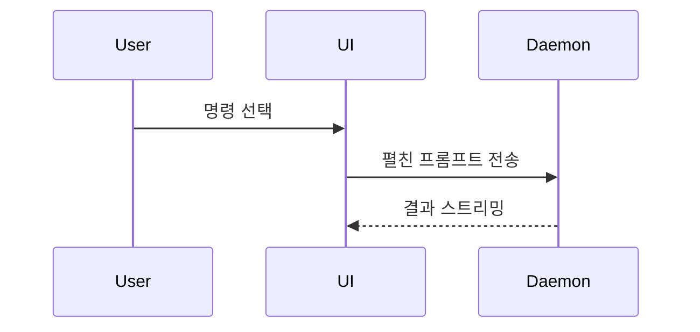

PR 본문은 이 템플릿으로 쓴다.

```markdown
## 요약

<다이어그램, diff 스케치, 또는 트리>

## 근거

- **변경 전:** <스크린샷/출력/실패하는 테스트 실행 결과>
  **변경 후:** <스크린샷/출력/통과하는 테스트 실행 결과>

## 병합 위험

**되돌릴 수 있는지:** <되돌릴 수 없는 변경 또는 되돌릴 수 있는 변경>

<선택: 설명>

**영향 범위:** <한 단어 설명>

<선택: 병합했을 때 생길 수 있는 결과>
```

## 섹션

서론은 모두 빼고 설명은 짧게 쓴다. `GLOSSARY.md`에 있는 사용자의 공통 언어(ubiquitous language, 팀과 코드가 함께 쓰는 도메인 용어)를 쓴다.

### 요약

핵심을 분명하게 보여 주는 가장 작은 형태를 고른다.

- 로직이나 알고리즘은 의사 코드로 보여 준다.

```text
on(save)
  내용이 바뀌지 않았으면
    캐시된 결과를 반환한다
  새 내용을 쓴다
  새 결과를 반환한다
```

- 실행 중 제어 흐름은 호출 트리로 보여 준다.

```text
submitForm
  createSession
    persistPrompt
    launchAgent
  navigateToSession
```

- UI 구조는 컴포넌트 트리로 보여 주고, 중요한 상태와 모듈 경계를 함께 적는다.

```text
<SessionPage> (apps/example/src/routes/session.tsx)
  useSessionEvents()
  <SessionToolbar>
    <RunSkillButton> (packages/ui)
```

- 파일별 책임이나 광범위 리팩터링은 얕은 파일 트리로 보여 준다.

```text
src/
├── commands/       # 사용자 동작을 파싱한다
├── sessions/       # 세션 상태를 관리한다
└── transport/      # API 요청을 보낸다
```

- 컴포넌트 사이의 상호작용, 제어 흐름, 데이터 흐름은 Mermaid로 보여 준다.



- 무엇이 바뀌는지가 핵심이고 주변 구조는 이미 있을 때는 `diff`를 쓴다. diff 형태는 주제에 맞춘다.

컴포넌트 변경:

```diff
 <SessionPage>
   useSessionEvents()
   <SessionToolbar>
+    <RunSkillButton />
   <SessionTimeline>
+    <SkillResultCard />
```

파일 구성 변경:

```diff
 src/
 ├── commands/
+│   └── show-me.ts       # 슬래시 명령을 펼친다
 ├── sessions/
-└── transport.ts
+└── transport/
+    ├── client.ts
+    └── stream.ts
```

호출 트리나 호출 스택 변경:

```diff
 submitForm
   createSession
     persistPrompt
+    expandSkillMention
     launchAgent
-  navigateToSession
+  navigateToSession
+    subscribeToEvents
```

상태나 제어 흐름 변경:

```diff
 on(save)
-  내용을 쓴다
+  내용이 바뀌지 않았으면
+    캐시된 결과를 반환한다
+  새 내용을 쓴다
+  캐시를 무효화한다
```

- 블록 대부분이 새 코드일 때, 생략하면 누가 무엇을 맡는지나 순서가 가려질 때, 사용자가 그대로 복사할 목표 형태가 필요할 때는 블록 전체를 보여 준다.

```ts
function expandSkill(command: string): string {
  const skillName = command.slice(1);
  return `use the ${skillName} skill`;
}
```

#### 안내

각 시각 자료는 그것이 뒷받침하는 짧은 설명 바로 옆에 둔다. 사용자의 현재 질문에 답하거나 현재 논의 중인 쟁점의 선택지를 정리하는 데 필요한 호출, 파일, props, 상태, 경계만 남긴다.

이 가운데 하나를 쓸 수도 있고 여러 개를 쓸 수도 있지만, 전부 쓸 일은 거의 없다. 판단해서 고르고, 사용자가 한꺼번에 너무 많은 것을 보지 않게 한다.

### 근거

변경이 동작한다는 구체적인 근거다. 변경 전과 변경 후를 보여 준다.

환경이 갖춰져 있고 화면에 보이는 변경이라면 스크린샷이 가장 좋은 근거다.

실행 결과로 보여 주는 근거가 그다음으로 좋다. 테스트 결과, 콘솔 출력이 여기에 해당한다. 변경 전에는 실패하고 변경 후에는 통과하는 바로 그 테스트를 의사 코드로 보여 준다.

### 병합 위험

되돌릴 수 없는 변경인지 되돌릴 수 있는 변경인지 적는다. 되돌릴 수 있는 변경은 병합한 뒤에도 원래대로 돌릴 수 있지만, 되돌릴 수 없는 변경은 그럴 수 없다. 적은 비용으로 롤백할 수 있는 PR은 위험이 낮다. 파괴적인 작업이나 되돌리기 어려운 결정이 들어간 변경은 되돌릴 수 없는 변경이다.

영향 범위는 이 PR이 들여오는 변경이 영향을 줄 수 있는 범위다. 가능한 경우를 모두 따져 본다. 레이아웃 이동, 이 코드를 쓰는 쪽의 동작이 깨지는 문제, 모바일 반응형 문제 등이 예다.
