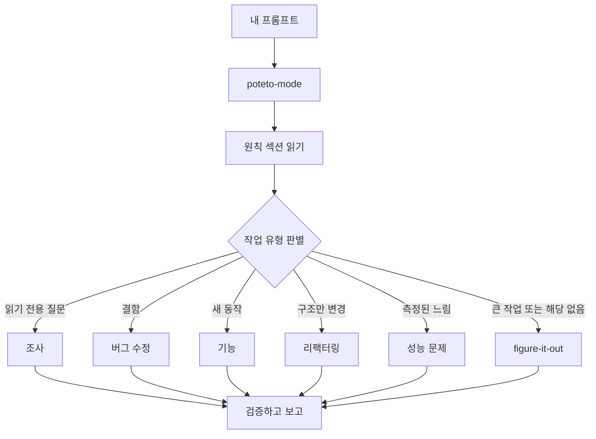

# `/poteto-mode`로 작업 라우팅하기

`/poteto-mode`는 정문이다. 목표를 주면 스물두 개 플레이북 중 하나에 맞추고, 그 플레이북의 단계를 할 일 목록에 복사하고, 단계에 필요한 다른 스킬을 부른다. 이 페이지에서는 좋은 프롬프트가 어떤 모습인지, 그리고 실제로는 얼마나 적게 써도 되는지 배운다.


## 프롬프트에 일어나는 일



다이어그램은 흔한 경로만 보여 준다. 그 밖에도 지표 hillclimb, 런타임 증상과 캡처된 트레이스 진단, 프로토타입, 시각적 동등성(visual parity), 스킬 작성과 평가, 자율 실행, PR 열기, PR이나 스택을 머지 가능 상태까지 돌보기, 검증된 스택 출시, PR 큐나 스택 오토파일럿, 세션 이어받기, 안전한 일시정지, 다단계 계획, worktree 정리용 플레이북이 있다. 전체 목록은 [플레이북 디렉터리](../../skills/poteto-mode/playbooks/)에 있다.

## 절차가 아니라 목표를 말한다

명세를 쓸 필요는 없다. 무엇이 잘못됐는지나 무엇을 원하는지, 거기에 에이전트의 시간을 아껴 줄 이미 아는 사실을 더해 말하면 된다.

```text
/poteto-mode 재시도하고 나면 사용자에게 알림이 두 번 가. 먼저 재현하고 고친 다음 검증해 줘.
```

이것이 Bug fix 프롬프트다. "repro first"는 예의가 아니라 진짜 제약이고, 플레이북은 이를 지킨다. 할 일 목록이 Bug fix 단계로 채워지는 것을 지켜보면 된다.

<a id="what-goes-in-a-prompt"></a>

## 프롬프트에 담을 것

쓸모 있는 프롬프트는 최대 다섯 가지를 담고, 각각 한 문장이면 된다.

- **목표.** 무엇이 잘못됐는지, 무엇을 원하는지 말한다.
- **완료 확인.** 통과하거나 실패할 수 있어야 한다. "더 좋게 만들어"나 "한 시간 동안 작업해"는 확인이 아니다.
- **보고 싶은 증거.** 실제 명령 출력, 흐름을 찍은 영상, 저장된 값, 전후 숫자를 요청한다.
- **이미 아는 것.** 증상, 재현 단계, 로그 한 줄, 링크가 있으면 에이전트가 찾아 헤매지 않아도 된다.
- **진짜 제약.** "repro first", "don't change any code yet", "zero behavior change", "let me review before proceeding"은 각각 에이전트의 행동을 바꾼다.

다섯 가지를 모두 담은 프롬프트는 이렇다.

```text
/poteto-mode 어제 배포 뒤로 CSV 내보내기에서 마지막 행이 빠져. 실패한 잡 id는 4812야. 먼저 재현하고 고쳐 줘. 6만 행짜리 픽스처가 행을 전부 내보내면 끝이야. 전후 행 수를 보여 줘.
```

빼는 편이 나은 것도 두 가지 있다.

- **방법.** 무엇을 이룰지만 말하고, 내가 고를 길보다 나은 길을 에이전트가 찾을 여지를 남긴다. 스킬 목록도 마찬가지인데, 아래 함정에서 다룬다.
- **처음부터 원인에 대한 내 가설.** 짐작을 말하면 탐색이 내가 가리킨 곳으로 좁아진다. 내 짐작을 꺼내기 전에 에이전트가 문제를 다시 서술하게 한다.

긴 스레드나 모호한 버그처럼 잡음이 많은 보고라면 다시 서술하기를 첫 단계로 둔다.

```text
/poteto-mode 이 스레드 읽어 봐. 근본 문제를 네 말로, 쉬운 말로 다시 정리해 줘. 아직 코드는 건드리지 마.
```

잘못 읽은 부분은 코드가 생기기 전에 서술에서 드러난다. 거기서 바로잡으면 잘못된 수정 하나 대신 메시지 하나로 끝난다. 플레이북 없이 다시 서술만 받으려면 [`/in-your-own-words`](../../skills/in-your-own-words/SKILL.md)를 돌린다. 에이전트가 생각하는 내 목표와 내가 풀려는 문제를 다시 말해 준다.

프롬프트가 제대로 겨냥됐는지 확신이 없으면 보내기 전에 [`/sharpen`](../../skills/sharpen/SKILL.md)을 돌린다.

```text
/sharpen v2 설정 형식 마이그레이션 가이드 써 줘.
```

에이전트는 최고 전문가라면 내가 요청하지 않았어도 할 일, 그들이 출발점으로 삼을 가장 날것의 자료, 그들이 쓸 방법과 도구, 그리고 나나 에이전트가 아닌 무엇이 결과가 맞음을 보여 줄지 말한다. 그런 다음 바로 그것을 요청하도록 프롬프트를 다시 쓴다. 더 크게가 아니라 더 깊게 쓴다. 다시 쓴 프롬프트는 실험으로 가를 수 있는 선택을 에이전트가 프로토타입으로 시험하고 관찰한 내용에서 옵션을 추천하게 하며, 제품과 취향의 선택은 내게 남긴다. 작업 자체는 하지 않는다. 다시 쓴 프롬프트를 읽고 보낸다. 예를 들어 `/poteto-mode`와 함께 보낸다.

## 후속 요청은 짧게

대화에 이미 맥락이 있으면 프롬프트는 거의 없어진다. 다음은 모두 충분하다.

```text
/poteto-mode 진행해
```

```text
계속해
```

```text
끝날 때까지 계속해
```

짧아도 되는 이유는 플레이북이 구조를 쥐고 있고, Custom Mode가 매 턴 `/poteto-mode`를 컨텍스트에 남겨 두기 때문이다. 시작하는 법은 [pstack 설정](./01-setup.md#run-your-first-task)에 있다. 말은 의도를 싣고, 엄밀함은 스킬이 싣는다.

## "new task"로 작업 바꾸기

긴 채팅에는 지난 작업의 맥락이 쌓인다. 주제를 바꿀 때는 그렇다고 말한다.

```text
/poteto-mode 새 작업이야. 로그아웃해도 캐시 항목이 남는 이유를 알아내 줘. 아직 코드는 건드리지 마.
```

"new task"는 `/poteto-mode`에게 이전 플레이북을 이어 가지 말고 다시 맞추라고 알린다. "don't change any code yet"은 이번 작업을 Investigation에 고정한다. 이 두 표현이 없으면 Feature 도중의 모드는 질문을 다음 기능 단계로 다루기 쉽다.

## 병렬 작업에는 전용 머신을

컴퓨터 한 대에서 한 저장소에 에이전트 여러 개를 돌리면 작업 트리와 포트, 빌드 출력을 두고 싸운다. 가장 깔끔한 격리는 [cloud subagent](https://cursor.com/docs/subagents#cloud-subagents)다. 각각 자기 VM과 브랜치를 받으므로 내 머신을 건드리지 않고 의존성을 설치하고 앱을 돌리고 결과를 영상으로 찍을 수 있다. 작업 앞에 `/in-cloud`를 입력하거나 부모 채팅에 cloud subagent로 일을 넘기라고 한다.

로컬에 남아야 하는 작업이라면 처음부터 worktree를 요청한다.

```text
/poteto-mode 새 작업이야. 새 worktree에서 <base>로부터 브랜치를 따고, 거기로 파서 변경을 옮겨 줘.
```

작업마다 자기 브랜치와 worktree를 가지면 어떤 에이전트도 다른 에이전트의 파일을 짓밟지 않는다. worktree는 디스크와 머신 자원을 쓰므로 노트북 한 대에서는 몇 개만 동시에 돌린다. [Opening a PR 플레이북](../../skills/poteto-mode/playbooks/opening-a-pr.md)은 코드 변경을 이미 worktree에서 처리하므로, 특정 base나 위치가 중요할 때만 이렇게 말하면 된다.

worktree는 쌓인다. 디스크가 빠듯해지면 이렇게 묻는다.

```text
/poteto-mode 디스크를 뭐가 잡아먹고 있어? 지워도 안전한 worktree는 정리해 줘.
```

[Worktree cleanup 플레이북](../../skills/poteto-mode/playbooks/worktree-cleanup.md)은 모든 worktree를 머지 상태, 커밋하지 않은 작업, 아직 그것을 건드리는 채팅 기준으로 분류한다. 그 증거로 안전이 확인된 것만 지우고, 커밋하지 않은 작업이 남은 것은 멈춰서 판단을 기다린다.

## 돌려 두고 자리 비우기

자리를 비울 때는 완료가 무엇인지 말하고 떠난다.

```text
/poteto-mode 나 잠깐 자리 비운다. 마이그레이션 검사에서 옛 호출부가 0개로 나올 때까지 계속해. 결정은 기록해 둬.
```

나중에 검토할 작업은 [`/figure-it-out`](../../skills/figure-it-out/SKILL.md)으로 간다. 이 스킬은 실행의 phase를 설계하고 [`/show-me-your-work`](../../skills/show-me-your-work/SKILL.md) 결정 로그를 남긴다. 밤샘 실행의 전체 약속은 [잠든 사이에 작업 돌리기](./07-overnight.md)에서 다룬다.

**함정:** 프롬프트에 스킬을 나열하지 않는다("use /architect, then /arena, then /interrogate..."). 플레이북이 이미 순서를 정해 두었고, 손으로 쓴 순서는 플레이북이 지켰을 단계를 뒤바꾸거나 빠뜨리기 일쑤다. 특정 선택을 덮어쓰고 싶을 때만 스킬 이름을 댄다.

전체 라우팅 규칙은 [`poteto-mode`](../../skills/poteto-mode/SKILL.md) 자체를 읽는다.

다음: [코드 이해하기](./03-understand.md).
