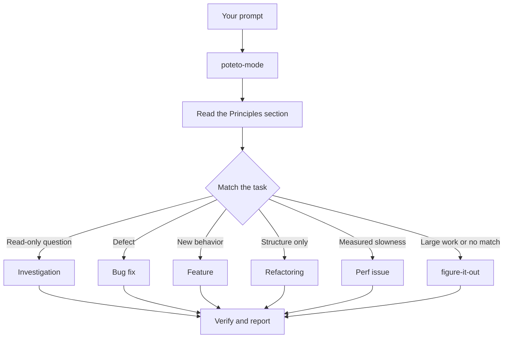

# `/poteto-mode`로 작업 라우팅하기

`/poteto-mode`는 정문이다. 목표를 주면 스물세 개 플레이북 중 하나에 맞추고, 그 플레이북의 단계를 할 일 목록에 복사하고, 단계에 필요한 다른 스킬을 부른다. 이 페이지에서는 좋은 프롬프트가 어떤 모습인지, 그리고 실제로는 얼마나 적게 써도 되는지 배운다.


## 프롬프트에 일어나는 일



다이어그램은 흔한 경로만 보여 준다. 그 밖에도 지표 hillclimb, 런타임 증상과 캡처된 트레이스 진단, 프로토타입, 시각적 동등성(visual parity), 스킬 작성과 평가, 자율 실행, PR이나 스택을 머지 가능 상태까지 돌보기, 검증된 스택 출시, PR 큐 오토파일럿, 프로젝트 규모 프로그램 조율, 세션 이어받기, 안전한 일시정지, 다단계 계획, worktree 정리용 플레이북이 있다. 전체 목록은 [플레이북 디렉터리](../../skills/poteto-mode/playbooks/)에 있다.

## 절차가 아니라 목표를 말한다

명세를 쓸 필요는 없다. 무엇이 잘못됐는지나 무엇을 원하는지, 거기에 에이전트의 시간을 아껴 줄 이미 아는 사실을 더해 말하면 된다.

```text
/poteto-mode users get two notifications after a retry. repro first, then fix and verify.
```

이것이 Bug fix 프롬프트다. "repro first"는 예의가 아니라 진짜 제약이고, 플레이북은 이를 지킨다. 할 일 목록이 Bug fix 단계로 채워지는 것을 지켜보면 된다. 건너뛴 단계도 `skip: <reason>`을 달고 보이는 채로 남는다.

대화에 이미 맥락이 있으면 프롬프트는 거의 없어진다. 다음은 모두 충분하다.

```text
/poteto-mode do it
```

```text
continue
```

```text
keep going until done
```

짧아도 되는 이유는 모드가 유지되고 플레이북이 구조를 쥐고 있기 때문이다. 말은 의도를 싣고, 엄밀함은 스킬이 싣는다.

## "new task"로 작업 바꾸기

긴 채팅에는 지난 작업의 맥락이 쌓인다. 주제를 바꿀 때는 그렇다고 말한다.

```text
/poteto-mode new task. figure out why the cache entry survives logout. don't change any code yet.
```

"new task"는 `/poteto-mode`에게 이전 플레이북을 이어 가지 말고 다시 맞추라고 알린다. "don't change any code yet"은 이번 작업을 Investigation에 고정한다. 이 두 표현이 없으면 Feature 도중의 모드는 질문을 다음 기능 단계로 다루기 쉽다.

## 병렬 작업에는 전용 worktree를

한 저장소에 에이전트 여러 개를 돌리면 작업 트리를 두고 싸운다. 처음부터 격리를 요청한다.

```text
/poteto-mode new task. branch off <base> in a fresh worktree, then port the parser change there.
```

작업마다 자기 브랜치와 worktree를 가지면 어떤 에이전트도 다른 에이전트의 파일을 짓밟지 않는다. [Opening a PR 플레이북](../../skills/poteto-mode/playbooks/opening-a-pr.md)은 코드 변경을 이미 worktree에서 처리하므로, 특정 base나 위치가 중요할 때만 이렇게 말하면 된다.

worktree는 쌓인다. 디스크가 빠듯해지면 이렇게 묻는다.

```text
/poteto-mode what's eating my disk? prune the worktrees that are safe to prune.
```

[Worktree cleanup 플레이북](../../skills/poteto-mode/playbooks/worktree-cleanup.md)은 모든 worktree를 머지 상태, 커밋하지 않은 작업, 아직 그것을 건드리는 채팅 기준으로 분류한다. 그 증거로 안전이 확인된 것만 지우고, 커밋하지 않은 작업이 남은 것은 멈춰서 판단을 기다린다.

## 돌려 두고 자리 비우기

자리를 비울 때는 완료가 무엇인지 말하고 떠난다.

```text
/poteto-mode im stepping away. keep going until the migration check reports zero old callers. log your decisions.
```

나중에 검토할 작업은 [`/figure-it-out`](../../skills/figure-it-out/SKILL.md)으로 간다. 이 스킬은 실행의 phase를 설계하고 [`/show-me-your-work`](../../skills/show-me-your-work/SKILL.md) 결정 로그를 남긴다. 밤샘 실행의 전체 약속은 [잠든 사이에 작업 돌리기](./07-overnight.md)에서 다룬다.

**함정:** 프롬프트에 스킬을 나열하지 않는다("use /how, then /architect, then /arena..."). 플레이북이 이미 순서를 정해 두었고, 손으로 쓴 순서는 플레이북이 지켰을 단계를 뒤바꾸거나 빠뜨리기 일쑤다. 특정 선택을 덮어쓰고 싶을 때만 스킬 이름을 댄다.

전체 라우팅 규칙은 [`poteto-mode`](../../skills/poteto-mode/SKILL.md) 자체를 읽는다.

다음: [코드 이해하기](./03-understand.md).
