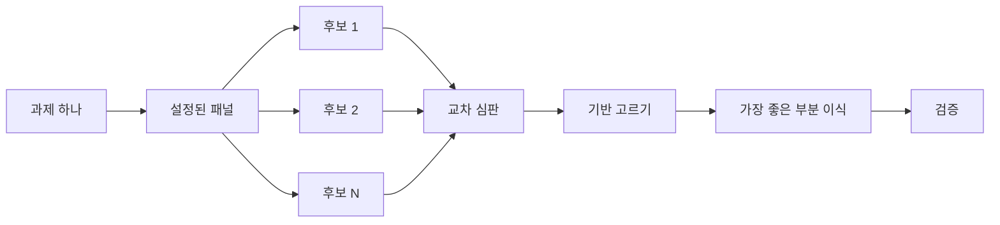

# 코드를 쓰기 전에 설계한다

어려운 설계를 한 번에 시도하면 모델이 처음 떠올린 모양에 갇힌다. `/architect`는 구현 전에 타입과 경계를 정한다. `/arena`는 같은 과제를 여러 번 시도하게 하고 가장 좋은 부분을 합친다. `/interrogate`는 다른 모델들이 결과를 깨뜨려 보게 한다. 설계 종합이 아니라 커버리지가 목적이면 `/swarm`이 조각이나 경주를 펼쳐 놓고 결과를 모은다.


## `/architect`로 모양을 정한다

```text
/architect design the import pipeline before writing any code. i care most about how callers use it.
```

[`/architect`](../../skills/architect/SKILL.md)는 먼저 기반을 다진다. 설계가 건드리는 코드에 `/how`를 돌리고, 소유권이나 계층을 옮기는 설계라면 `/why`도 돌린다. 그다음 `/arena`를 돌려 경쟁하는 설계 스케치를 만든다. 각 스케치는 호출자의 사용법을 맨 먼저 쓰고, 이어서 타입, 시그니처, 모듈 맵을 쓴다.

기본적으로는 종합한 설계에서 곧장 구현으로 넘어간다. 설계를 먼저 보고 싶으면 그렇게 말한다.

```text
/architect with checkpoint. stop and show me before implementing.
```

## `/arena`로 시도를 펼친다

```text
/arena take my prompt to the arena verbatim. i want to compare their proposals with yours.
```

[`/arena`](../../skills/arena/SKILL.md)는 그 밑에 깔린 범용 도구다. subagent N개가 같은 설계나 코드 과제를 병렬로 시도하고, 각자 자기 worktree나 디렉터리에 쓴다. 설정이 허락하면 다른 모델 계열의 읽기 전용 심판이 모든 후보를 기준표에 따라 채점한다. 조정자는 후보마다 처음부터 끝까지 읽고, 기반을 하나 고르고, 탈락한 후보에서 가장 좋은 아이디어를 이식하고, 결과를 검증한다.



패널은 [`/setup-pstack`](../../skills/setup-pstack/SKILL.md) 설정에서 오고, 과제마다 조정할 수 있다. 중요한 결정이면 후보를 더 요청하고, 아니면 덜 요청한다.

```text
/arena this, 5 candidates. the cache key format is expensive to change later.
```

## `/swarm`으로 조각과 경주를 커버한다

```text
/swarm check every package under packages/ against its check.sh. one worker per package. one report.
```

[`/swarm`](../../skills/swarm/SKILL.md)은 worker N개를 독립된 조각, 커버리지 매트릭스, 시험 레인, 탐색 분할, 미리 선언한 경주 갈래에 펼친다. worker마다 자기 범위와 검사를 받고 `PASS`, `ISSUES`, `BLOCKED` 중 하나를 보고한다. 부모는 worker들을 기다렸다가 빈틈이나 이탈을 담은 간결한 보고서 하나를 돌려준다.

병렬로 돌려서 커버리지를 얻거나 독립된 검사끼리 경주시킬 수 있을 때 쓴다. `/arena`는 모든 worker에게 같은 설계나 코드 과제를 주고, 기반을 골라 가장 좋은 부분을 이식한다. `/swarm`은 조각을 커버하거나, 선택 규칙을 미리 선언한 경주를 돌린다. 기반 선택과 이식 절차는 쓰지 않는다.

## `/interrogate`로 깨뜨려 본다

```text
/interrogate the whole branch, but skeptically. no nitpicks unless it's an actual bug or regression.
```

[`/interrogate`](../../skills/interrogate/SKILL.md)는 같은 diff, 의도, 기준표를 서로 다른 모델 계열의 리뷰어 여럿에게 보낸다. 핵심은 모델의 다양성이다. 모델마다 사각지대가 달라서, 두 모델이 따로 제기한 발견은 신뢰도가 높은 신호다. 리드는 모든 것을 `Act on`(조치), `Consider`(고려), `Noted`(참고), `Dismissed`(기각)로 분류하고, 기각마다 이유를 달며, 아무것도 자동으로 적용하지 않는다.

기각한 것도 읽는다. 리드는 실용적인 시니어 엔지니어이지 신탁이 아니며, 그 판단을 뒤집을 수 있다.

## 과제에 설계 작업이 얼마나 필요한가

모든 변경에 이게 필요한지 궁금할 수 있다. 아니다. 대부분의 변경에는 하나도 필요 없다. 대략의 단계는 이렇다.

- 확신이 서지 않는 작고 완성된 변경에는 `/interrogate`만 있으면 된다.
- 함수 경계를 넘거나 소유권을 옮기는 변경에는 `/architect`를 쓰고, 그러면 `/arena`도 따라온다.
- 이름, 형식, 알고리즘처럼 독립된 시도가 도움이 되는 단독 결정에는 `/arena`를 바로 쓴다.
- 커버리지 매트릭스, 병렬 검사 묶음, 갈래를 선언한 경주에는 `/swarm`을 쓴다.
- 되돌리기 비싸고 의견이 갈리는 설계에는 `/architect`를 쓰고, 출시 전에 `/interrogate`를 쓴다.

`/poteto-mode`는 이미 이 단계를 적용한다. 경계를 넘는 작업은 알아서 `/architect`를 부르므로, 이 명령들을 직접 쓰는 것은 주로 기본보다 더 많거나 적은 검토를 원할 때다.

다음: [변경을 만들고 정리하기](./05-build-and-clean.md).
