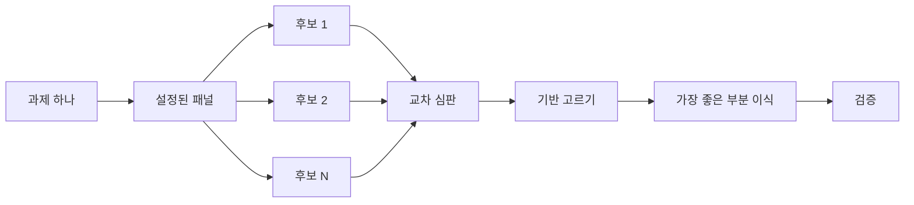

# 코드를 쓰기 전에 설계한다

어려운 설계를 한 번에 시도하면 모델이 처음 떠올린 모양에 갇힌다. `/architect`는 구현 전에 타입과 경계를 정한다. `/arena`는 같은 과제를 여러 번 시도하게 하고 가장 좋은 부분을 합친다. `/interrogate`는 다른 모델들이 결과를 깨뜨려 보게 한다. 설계 종합이 아니라 커버리지가 목적이면 `/swarm`이 조각이나 경주를 펼쳐 놓고 결과를 모은다.

가장 흔한 설계 실수 두 가지는 에이전트의 첫 설계를 그대로 받는 것과 어떤 코드로도 시험하지 않은 계획을 다듬는 것이다. 이 페이지는 둘 다 바로잡는다. 계획은 코드로 세운다. 프로토타입이 열린 질문에 답하고, README나 튜토리얼이 목표를 정하며, 글로 쓴 계획은 맨 마지막에 온다.


## `/architect`로 모양을 정한다

```text
/architect 코드 쓰기 전에 import 파이프라인부터 설계해 줘. 호출부에서 어떻게 쓰는지가 제일 중요해.
```

[`/architect`](../../skills/architect/SKILL.md)는 먼저 기반을 다진다. 설계가 건드리는 코드에 `/how`를 돌리고, 소유권이나 계층을 옮기는 설계라면 `/why`도 돌린다. 그다음 `/arena`를 돌려 경쟁하는 설계 스케치를 만든다. 각 스케치는 호출자의 사용법을 맨 먼저 쓰고, 이어서 타입, 시그니처, 모듈 맵을 쓴다.

기본적으로는 종합한 설계에서 곧장 구현으로 넘어간다. 설계를 먼저 보고 싶으면 그렇게 말한다.

```text
/architect 체크포인트 포함. 구현 전에 멈추고 보여 줘.
```

코드를 쓰기 시작하면 설계는 신성하지 않다. 구현 중에 서로 무관한 곳에서 같은 우회책이 나오거나 `any`나 강제 캐스트로만 컴파일되는 타입이 보이면, `/architect`는 이를 설계가 틀렸다는 증거로 본다. 땜질하지 않고 스케치를 버린 뒤 처음부터 다시 시작한다.

## `/arena`로 시도를 펼친다

```text
/arena 내 프롬프트를 그대로 아레나에 넘겨. 다른 모델 제안을 네 것과 비교하고 싶어.
```

[`/arena`](../../skills/arena/SKILL.md)는 그 밑에 깔린 범용 도구다. subagent N개가 같은 설계나 코드 과제를 병렬로 시도하고, 각자 자기 worktree나 디렉터리에 쓴다. 설정이 허락하면 다른 모델 계열의 읽기 전용 심판이 모든 후보를 기준표에 따라 채점한다. 조정자는 후보마다 처음부터 끝까지 읽고, 기반을 하나 고르고, 탈락한 후보에서 가장 좋은 아이디어를 이식하고, 결과를 검증한다.



패널은 [`/setup-pstack`](../../skills/setup-pstack/SKILL.md) 설정에서 오고, 과제마다 조정할 수 있다. 중요한 결정이면 후보를 더 요청하고, 아니면 덜 요청한다.

```text
/arena 이거 후보 5개로. 캐시 키 형식은 나중에 바꾸기 비싸.
```

## `/swarm`으로 조각과 경주를 커버한다

```text
/swarm packages/ 아래 패키지마다 check.sh로 검사해 줘. 패키지당 워커 하나, 보고서는 하나로.
```

[`/swarm`](../../skills/swarm/SKILL.md)은 worker N개를 독립된 조각, 커버리지 매트릭스, 시험 레인, 탐색 분할, 미리 선언한 경주 갈래에 펼친다. worker마다 자기 범위와 검사를 받고 `PASS`, `ISSUES`, `BLOCKED` 중 하나를 보고한다. 부모는 worker들을 기다렸다가 빈틈이나 이탈을 담은 간결한 보고서 하나를 돌려준다.

병렬로 돌려서 커버리지를 얻거나 독립된 검사끼리 경주시킬 수 있을 때 쓴다. `/arena`는 모든 worker에게 같은 설계나 코드 과제를 주고, 기반을 골라 가장 좋은 부분을 이식한다. `/swarm`은 조각을 커버하거나, 선택 규칙을 미리 선언한 경주를 돌린다. 기반 선택과 이식 절차는 쓰지 않는다.

## `/interrogate`로 깨뜨려 본다

```text
/interrogate 브랜치 전체를 의심하면서 봐 줘. 실제 버그나 회귀가 아니면 사소한 지적은 빼.
```

[`/interrogate`](../../skills/interrogate/SKILL.md)는 같은 diff, 의도, 기준표를 서로 다른 모델 계열의 리뷰어들에게 보낸다. 핵심은 모델의 다양성이다. 모델마다 사각지대가 달라서, 두 모델이 따로 제기한 발견은 신뢰도가 높은 신호다. 리드는 모든 것을 `Act on`(조치), `Consider`(고려), `Noted`(참고), `Dismissed`(기각)로 분류하고, 기각마다 이유를 달며, 아무것도 자동으로 적용하지 않는다.

기각한 것도 읽는다. 리드는 실용적인 시니어 엔지니어이지 신탁이 아니며, 그 판단을 뒤집을 수 있다.

## 논쟁 대신 프로토타입

첫 설계를 그대로 받지 않는다. 몇 가지를 요청하고, 눈으로 볼 수 있는 증거로 고른다.

```text
/poteto-mode 새 드롭다운 메뉴 시안을 몇 개 프로토타입으로 만들어 줘. 비교할 수 있게 스크린샷이나 영상을 찍어 줘.
```

[Prototype 플레이북](../../skills/poteto-mode/playbooks/prototype.md)은 scratch 디렉터리에 버릴 스케치를 만들고, 변형들을 전환기 하나 뒤에 두고, 각각을 직접 돌려 스크린숏이나 시간을 잰다. UI뿐 아니라 동작과 알고리즘에도 통한다. 프로토타입은 코드로 하는 계획이다. 에이전트가 나에게 묻는 대신 무언가를 돌려서 스스로 열린 질문에 답하게 하고, 내가 떠올리지 못했을 선택지가 나올 여지를 남긴다.

같은 생각은 실제 설계로도 커진다. `/architect`와 프로토타입을 짝짓고 리뷰 관문을 둔다.

```text
/poteto-mode 외부 웹훅에 레이트 리밋이 필요해. 먼저 /architect 로 설계하고, 열린 질문은 프로토타입으로 답해. 진행하기 전에 내가 검토할게.
```

추상적인 계획에 리뷰어를 쓰지 않는다. `/interrogate`는 diff에 쓰는 것이다. 코드가 뒤에 없는 계획에 적대적 리뷰를 겨누면 리뷰어들은 결코 일어나지 않을 이론적 위험과 엣지 케이스를 지어낸다. 프로토타입으로 질문을 정리하고, 그다음 만들어진 것을 리뷰한다.

## 공유 코드에는 README부터

다른 코드가 쓸 패키지나 API라면 사용자가 읽을 문서부터 시작한다.

```text
/poteto-mode 새 config 패키지를 내가 어떻게 쓸지 튜토리얼부터 써 줘. 그다음 /teach 로 지금 것보다 왜 나은지 알려 줘.
```

튜토리얼을 먼저 쓰면 호출하는 쪽의 시점을 강제로 갖게 된다. 가상의 사용자에게 API를 설명하고, 거기서 거꾸로 구현으로 간다. 문서는 에이전트가 자기 작업을 대조할 구체적인 목표도 된다. 문서 자체가 중요하면 [`/technical-writing`](../../skills/technical-writing/SKILL.md)을 지목해, 튜토리얼이 레퍼런스와 설명으로 한꺼번에 흘러가지 않고 튜토리얼로 남게 한다.

## 설계가 정해진 뒤에 계획하기

pstack에는 일부러 계획 스킬이 없다. 글로 된 계획이 정말 필요하면 설계가 정해진 뒤에 요청한다.

```text
/poteto-mode 이 설계를 계획으로 바꿔 줘. 검증 가능한 작은 PR로 나누고, PR마다 검증 단계를 붙여.
```

[Multi-phase plan 플레이북](../../skills/poteto-mode/playbooks/multi-phase-plan.md)은 남은 열린 질문을 프로토타입으로 정리한 뒤, PR마다 한 섹션을 쓰고 각 섹션을 변경이 동작한다는 증거로 끝맺는다. 테스트 스위트 통과만으로는 그 증거가 되지 않는다. 산출물은 계획이다. 플레이북은 계획을 구현하지 않고, 다음에 어떤 실행 플레이북이 돌려야 하는지 짚어 준다.

마이그레이션이라면 프롬프트에 기준을 적는다.

```text
/poteto-mode 우리 UI 라이브러리를 새 스타일링 시스템으로 옮기는 계획을 세워 줘. 검증 가능한 작은 PR로 나누고, PR마다 시각 회귀 검사를 붙여. 결과는 버그까지 포함해서 원본과 똑같아야 해.
```

"bugs included"는 마이그레이션이 도중에 슬쩍 고치는 일을 막는다. 그러면 옛 출력과 새 출력을 비교할 수 없게 되기 때문이다. 여러 날에 걸친 프로젝트라면 계획을 한동안 저장소에 커밋해 다른 에이전트가 진행 중인 작업을 보게 할 수 있다. 작업이 반영되면 지운다.

## 과제에 설계 작업이 얼마나 필요한가

모든 변경에 이게 필요한지 궁금할 수 있다. 아니다. 대부분의 변경에는 하나도 필요 없다. 대략의 단계는 이렇다.

- 확신이 서지 않는 작고 완성된 변경에는 `/interrogate`만 있으면 된다.
- 함수 경계를 넘거나 소유권을 옮기는 변경에는 `/architect`를 쓰고, 그러면 `/arena`도 따라온다.
- 이름, 형식, 알고리즘처럼 독립된 시도가 도움이 되는 단독 결정에는 `/arena`를 바로 쓴다.
- 커버리지 매트릭스, 병렬 검사 묶음, 갈래를 선언한 경주에는 `/swarm`을 쓴다.
- 레이아웃, 시간, 접근법처럼 무언가를 돌려 답할 수 있는 열린 질문에는 논쟁이 아니라 프로토타입을 쓴다.
- 되돌리기 비싸고 의견이 갈리는 설계에는 `/architect`를 쓰고, 출시 전에 `/interrogate`를 쓴다.
- PR 여러 개에 걸친 작업에는 설계가 정해진 뒤에 쓴 계획을 쓴다.

`/poteto-mode`는 이미 이 단계를 적용한다. 경계를 넘는 작업은 알아서 `/architect`를 부르므로, 이 명령들을 직접 쓰는 것은 주로 기본보다 더 많거나 적은 검토를 원할 때다.

다음: [변경을 만들고 정리하기](./05-build-and-clean.md).
