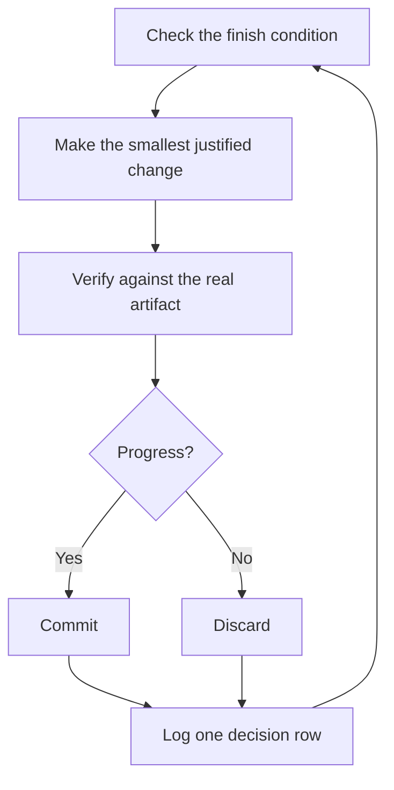

# 자는 동안 작업 돌리기

앞의 모든 것이 여기서 결실을 맺는다. 자기 작업을 스스로 검증한다고 믿을 수 있는 에이전트라면 어려운 작업을 맡기고 혼자 둘 수 있다. 그것을 안전하게 만드는 것은 희망이 아니다. 확인 가능한 종료 조건, 격리된 worktree, 아침에 감사하는 결정 로그다.


## 밤샘 계약

좋은 인계에는 목표, 종료 조건, 권한, 비상구가 있다. 길 필요는 없다.

```text
/poteto-mode im going to bed. migrate every caller to the new parser in a fresh worktree off <base>.
done means zero old callers, all parser fixtures pass, old api deleted.
keep a decision log. don't ask me before committing.
/loop until done. if you're truly stuck after a few hours, stop and write up why.
```

각 줄이 무엇을 얻어 주는지 살펴본다.

- "im going to bed"는 세션 오버라이드다. 에이전트가 묻기를 멈추고 계속 진행한다.
- "done means..."는 목표를 매 반복마다 돌릴 수 있는 점검으로 바꾼다.
- "fresh worktree off `<base>`"는 이 실행이 열어 둔 다른 작업과 부딪히지 않게 한다.
- "don't ask me before committing"은 에이전트가 원래라면 멈춰서 기다렸을 권한 질문에 미리 답한다.
- `/loop`는 pstack 스킬이 아니라 Cursor에 내장된 깨우기 장치다. [Autonomous run 플레이북](../../skills/poteto-mode/playbooks/autonomous-run.md)이 이벤트나 하트비트마다 종료 조건을 다시 확인하는 데 쓴다.
- 비상구가 있으면 진짜 막다른 길에서 멈추고 이유를 적을 수 있다. 여덟 시간 동안 목표를 창의적으로 재해석하는 것보다 낫다.

자리를 비운 뒤에 이 작업을 리뷰할 것이므로, `/poteto-mode`는 이 작업을 [`/figure-it-out`](../../skills/figure-it-out/SKILL.md)으로 보낸다. 이 스킬은 코드보다 먼저 실행 단계를 설계하고 결정 로그를 연결한다.

## 루프가 밤새 하는 일



반복마다 변경 하나, 점검 하나, 로그 한 줄이다. 도움이 안 된 변경은 그대로 두지 않고 버린다. 정체기는 멈추라는 뜻이 아니라 방향을 바꾸라는 뜻이고, 종료 조건은 승리를 선언하려고 슬그머니 느슨해지지 않는다.

## 아침 감사

[`/show-me-your-work`](../../skills/show-me-your-work/SKILL.md)가 실행을 리뷰할 수 있게 만든다. 각 행은 시간, 단계, 결정, 이유, 증거 위치, 결과를 `decisions.tsv`(여러 실행이 디렉터리를 공유하면 `.audit/<task-slug>.tsv`)라는 TSV에 기록한다. 기본으로 로컬에만 남는다. 리뷰어가 결과를 믿으려면 기록이 필요할 만큼 야심 찬 작업이면 커밋한다.

돌아오면 실행을 리뷰 형태로 요청한다.

```text
/show-me-your-work catch me up on what you did last night
```

스킬은 요약을 돌려주기 전에 다른 모델 계열의 리뷰어를 띄워 기록과 대화록을 읽게 하고, 답은 살펴볼 만한 것을 나열한 Attention 섹션으로 끝난다. 그 섹션을 먼저 읽고, 그다음 섹션이 가리키는 로그 행을 읽는다. 밤새 일어난 일을 전부 다시 읽는 것이 아니라 결정을 감사하는 것이다.

## 밤에 작업 하나가 아니라 대기열이 있을 때

위 계약은 작업 하나를 종료 조건 하나까지 끌고 간다. 어떤 밤에는 더 많은 것이 있다. 독립적인 변경의 대기열이나 프로그램 전체다. 플레이북 세 개가 같은 신뢰를 더 큰 규모로 넓힌다.

[Autopilot-full](../../skills/poteto-mode/playbooks/autopilot-full.md)은 독립적인 PR의 대기열을 병합까지 돌린다. PR마다 빌드부터 병합까지 책임지는 owner 에이전트가 하나씩 붙고, 어떤 owner도 자기 판정만으로 병합하지 않는다. 새로 띄운 검증자 무리가 owner의 코드 준비 완료 head에서 한 라운드를 시작하고, 이후 패치를 바꾸는 push마다 다시 시작한다. 병합될 패치에 대한 깨끗한 판정만이 병합을 허가한다.

```text
/poteto-mode full autopilot on this queue. each item is independent. i want them merged by morning.
```

[Autopilot-stack](../../skills/poteto-mode/playbooks/autopilot-stack.md)은 같은 owner 루프를 돌리지만 아무것도 내보내지 않는다. 일어나면 모든 고리에 검증자 판정이 붙은 선형 base-branch 스택 하나가 있고, 리뷰와 반영은 직접 한다. 변경끼리 얽혀 있거나, 무엇이든 병합되기 전에 직접 보고 싶으면 Autopilot-full 대신 이것을 고른다.

```text
/poteto-mode autopilot these five changes but stack them, don't ship. i'll land the stack in the morning.
```

[Orchestrate](../../skills/poteto-mode/playbooks/orchestrate.md)는 에이전트 하나의 수명보다 오래가는 프로그램을 위한 것이다. 여러 날에 걸치고, 쌓인 PR이 많고, 상주하는 코디네이터 채팅 하나 아래 subagent 무리가 일한다. 코디네이터는 브리프를 쓰고, subagent가 끝낸 것을 모으고, 병합되지 않은 가장 아래 PR을 초록색으로 유지하며, 코드는 직접 쓰지 않는다. 일부러 무거운 장치다. 에이전트 하나가 세션 하나에서 끝낼 수 있는 작업이면 플레이북이 스스로 위의 밤샘 계약으로 되돌려 보낸다.

```text
/poteto-mode orchestrate the store migration. own it until every package is converted and merged. i'll check in twice a day.
```

**함정:** 시간은 종료 조건이 아니다. "work on this for 4 hours"는 에이전트에게 확인할 것을 아무것도 주지 않고, 일어나면 결과 대신 네 시간 분량의 움직임만 남아 있다. `/loop`에는 통과하거나 실패할 수 있는 조건식을 준다.

다음: [원칙 이름으로 방향 잡기](./08-principles.md).
