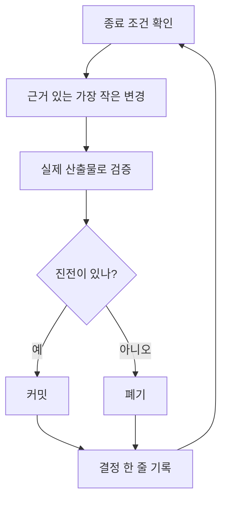

# 자는 동안 작업 돌리기

앞의 모든 것이 여기서 결실을 맺는다. 자기 작업을 스스로 검증한다고 믿을 수 있는 에이전트라면 어려운 작업을 맡기고 혼자 둘 수 있다. 그것을 안전하게 만드는 것은 희망이 아니다. 확인 가능한 종료 조건, 격리된 worktree나 클라우드 에이전트, 아침에 감사하는 결정 로그다.


## 루프보다 신뢰를 먼저 얻기

믿지 못하는 루프는 미검증 작업을 더 빨리 만들어 낼 뿐이고, 엉망은 반복할 때마다 불어난다. 루프를 돌려 두고 떠나기 전에 그럴 자격을 갖췄는지 확인한다.

- 작업을 직접 한 번 해 봤거나 에이전트가 하는 것을 지켜봐서, 좋은 결과가 어떤 모습인지 안다.
- 여러분이 직접 쓸 도구와 신호를 에이전트도 가지고 있다. 검증 스킬, 프로파일러, 로그.
- 모든 단계가 자기 작업을 증명하고, 작업이 기준에 못 미치면 라인을 멈출 수 있다.
- 실행 기록을 몇 개 읽고, 반복되는 실패를 도구나 스킬이나 검사로 바꿔 두었다.

네 가지가 모두 성립한 뒤에야 루프를 자율로 돌린다. 그전까지는 지켜보면서 돌린다.

## 밤샘 계약

좋은 인계에는 목표, 종료 조건, 권한, 비상구가 있다. 길 필요는 없다.

```text
/poteto-mode 나 이제 잔다. <base>에서 딴 새 worktree에서 호출부를 전부 새 파서로 옮겨 줘.
옛 호출부 0개, 파서 픽스처 전부 통과, 옛 API 삭제까지 되면 끝이야.
결정 기록을 남겨. 커밋 전에 나한테 묻지 마.
/loop 끝날 때까지. 몇 시간 해도 정말 막히면 멈추고 이유를 정리해 둬.
```

각 줄이 무엇을 얻어 주는지 살펴본다.

- "im going to bed"는 세션 오버라이드다. 에이전트가 묻기를 멈추고 계속 진행한다.
- "done means..."는 목표를 매 반복마다 돌릴 수 있는 점검으로 바꾼다.
- "fresh worktree off `<base>`"는 이 실행이 열어 둔 다른 작업과 부딪히지 않게 한다.
- "don't ask me before committing"은 에이전트가 원래라면 멈춰서 기다렸을 권한 질문에 미리 답한다.
- `/loop`는 pstack 스킬이 아니라 Cursor에 내장된 깨우기 장치다. [Autonomous run 플레이북](../../skills/poteto-mode/playbooks/autonomous-run.md)이 이벤트나 하트비트마다 종료 조건을 다시 확인하는 데 쓴다.
- 비상구가 있으면 진짜 막다른 길에서 멈추고 이유를 적을 수 있다. 여덟 시간 동안 목표를 창의적으로 재해석하는 것보다 낫다.

자리를 비운 뒤에 이 작업을 리뷰할 것이므로, `/poteto-mode`는 이 작업을 [`/figure-it-out`](../../skills/figure-it-out/SKILL.md)으로 보낸다. 이 스킬은 코드보다 먼저 실행 단계를 설계하고 결정 로그를 연결한다.

실행을 일부러 멈추려면 에이전트에게 멈추라고 하거나, 곧 오프라인이 되거나 Cursor를 재시작한다고 말한다. [Pause safely 플레이북](../../skills/poteto-mode/playbooks/pause-safely.md)은 지금 단계를 끝내거나 되돌리고, 작업 중 체크포인트를 커밋하고, 재개 메모를 쓴다. 새 채팅은 Session pickup 플레이북을 거쳐 그 메모에서 작업을 이어받는다. "계속해"라는 말은 결코 멈춤을 일으키지 않는다.

## 루프가 밤새 하는 일



반복마다 변경 하나, 점검 하나, 로그 한 줄이다. 도움이 안 된 변경은 그대로 두지 않고 버린다. 정체기는 멈추라는 뜻이 아니라 방향을 바꾸라는 뜻이고, 종료 조건은 승리를 선언하려고 슬그머니 느슨해지지 않는다.

## 아침 감사

[`/show-me-your-work`](../../skills/show-me-your-work/SKILL.md)가 실행을 리뷰할 수 있게 만든다. 각 행은 시간, 단계, 결정, 이유, 증거 위치, 결과를 `decisions.tsv`(여러 실행이 디렉터리를 공유하면 `.audit/<task-slug>.tsv`)라는 TSV에 기록한다. 기본으로 로컬에만 남는다. 리뷰어가 결과를 믿으려면 기록이 필요할 만큼 야심 찬 작업이면 커밋한다.

돌아오면 실행을 리뷰 형태로 요청한다.

```text
/show-me-your-work 어젯밤에 한 일 알려 줘
```

스킬은 요약을 돌려주기 전에 다른 모델 계열의 리뷰어를 띄워 기록과 대화록을 읽게 하고, 답은 살펴볼 만한 것을 나열한 Attention 섹션으로 끝난다. 그 섹션을 먼저 읽고, 그다음 섹션이 가리키는 로그 행을 읽는다. 밤새 일어난 일을 전부 다시 읽는 것이 아니라 결정을 감사하는 것이다.

감사 대신 상태만 빠르게 보려면 작업을 돌린 채팅에서 [`/ketchup`](../../skills/ketchup/SKILL.md)을 돌린다. 읽기만 하고, 마지막 메시지 이후 바뀐 것을 작업이 만든 스크린샷과 작은 다이어그램을 곁들여 쉬운 말로 알려 준다. 그런 다음 머지, 승인, 선택지 사이의 선택처럼 내 결정을 기다리는 일을 하나씩 나열하고, 각각에 추천, 증거, 위험을 붙인다. 그래서 답만 보고 결정할 수 있다.

## 밤에 작업 하나가 아니라 대기열이 있을 때

위 계약은 작업 하나를 종료 조건 하나까지 끌고 간다. 어떤 밤에는 더 많은 것이 있다. 독립적인 변경의 대기열이나 프로그램 전체다. 플레이북 세 개가 같은 신뢰를 더 큰 규모로 넓힌다.

[Autopilot-full](../../skills/poteto-mode/playbooks/autopilot-full.md)은 독립적인 PR의 대기열을 병합까지 돌린다. PR마다 빌드부터 병합까지 책임지는 owner 에이전트가 하나씩 붙고, 어떤 owner도 자기 판정만으로 병합하지 않는다. 새로 띄운 검증자 무리가 owner의 코드 준비 완료 head를 검사한다. 이후의 rebase나 사소한 수정은 새 검증자 하나가 확인하고, 새 동작이나 큰 새 diff가 생겼을 때만 검증자 무리 전체를 다시 부른다. 병합될 패치에 대한 깨끗한 판정만이 병합을 허가한다.

```text
/poteto-mode 이 큐를 완전 자동으로 처리해 줘. 항목끼리는 독립적이야. 아침까지 머지돼 있으면 좋겠어.
```

[Autopilot-stack](../../skills/poteto-mode/playbooks/autopilot-stack.md)은 병합을 뺀 Autopilot-full이다. 일어나면 각자 판정이 붙은 검증된 PR들이 있고, 리뷰와 반영은 직접 한다. PR은 그것이 기반으로 삼는 PR 위에만 쌓인다. 무엇이든 병합되기 전에 직접 보고 싶으면 Autopilot-full 대신 이것을 고른다.

```text
/poteto-mode 이 변경 다섯 개를 자동으로 진행하되 병합은 하지 마. 아침에 내가 랜딩할게.
```

[Orchestrate](../../skills/poteto-mode/playbooks/orchestrate.md)는 에이전트 하나의 수명보다 오래가는 프로그램을 위한 것이다. 여러 날에 걸치고, 쌓인 PR이 많고, 상주하는 코디네이터 채팅 하나 아래 subagent 무리가 일한다. 코디네이터는 각 작업을 어느 에이전트가 맡을지 정하고, 각자 만든 것을 확인하며, 코드는 직접 쓰지 않는다. 에이전트 하나가 세션 하나에서 끝낼 수 있는 작업이면 플레이북이 스스로 위의 밤샘 계약으로 되돌려 보낸다.

```text
/poteto-mode store 마이그레이션을 지휘해 줘. 모든 패키지가 전환되고 머지될 때까지 네가 책임져. 나는 하루에 두 번 들여다볼게.
```

<a id="run-many-projects-in-parallel"></a>

## 여러 프로젝트를 병렬로 돌리기

[Cursor Project](https://cursor.com/blog/projects)는 코디네이터 에이전트 하나에게 지속되는 스레드를 준다. 코디네이터는 코드를 쓰지 않는다. 서브에이전트를 지휘하고, 서브에이전트는 기본적으로 클라우드에서 돌기 때문에 노트북을 덮어도 작업이 계속된다. Orchestrate 플레이북이 기대하는 모양이 바로 이것이다. 코디네이터에게 보내는 프롬프트를 `/poteto-mode`로 시작하면, 코디네이터가 띄운 서브에이전트들이 플레이북을 따른다.

도움이 되는 습관 몇 가지:

- 기능, 마이그레이션, 성능 개선, 기술 부채 정리처럼 작업 덩어리마다 Project를 따로 준다. 여러 개를 나란히 돌릴 수 있다.
- 관련 채팅을 끝난 것까지 Project 안으로 끌어다 놓는다. 그 안의 모든 에이전트에게 맥락이 된다.
- 머지 전에 PR마다 검증 swarm을 붙이고, 대기열은 Autopilot-stack이나 Autopilot-full에 맡긴다.
- 코디네이터에게 데이터로 뒷받침된 계획을 요구하고, 열린 질문은 여러분에게 묻기 전에 프로토타입으로 답하게 한다.

프롬프트 하나로 조사부터 실행까지 Project 전체를 끌고 갈 수 있다.

```text
/poteto-mode 이 저장소를 에이전트가 다루기 쉬운 구조로 리팩터링해 줘. 지난 커밋과 리뷰 코멘트에 /correct 와 /architect 를 돌려서 여기서 에이전트가 가장 자주 하는 실수를 찾아. 지난 대화 맥락은 /recall 로 가져와. 열린 질문은 나한테 묻지 말고 프로토타입으로 답해. 실제 데이터로 뒷받침한 계획을 가져와. 내가 승인하면 autopilot-stack이나 autopilot-full로 실행하되, 어느 쪽으로 할지는 나한테 물어봐.
```

## 루프가 스스로 시작하게 하기

위의 모든 루프는 여전히 여러분이 시작해 주기를 기다린다. 예약되거나 이벤트로 움직이는 자동화는 그 단계를 없앤다. 소프트웨어 유지보수는 여기에 잘 맞는 단계로 나뉜다. 리포트를 분류하고, 재현하고, 고치고, 수정을 검증한다. 이런 라인을 믿을 만하게 지키는 규칙은 두 가지다.

- 모든 단계가 라인을 멈출 수 있다. 분류 단계는 리포트가 의도된 동작이라고 판단할 수 있고, 재현 단계는 재현에 실패할 수 있고, 수정 단계는 변경이 너무 위험하다고 판단할 수 있다. 이런 결과는 모두 쓸모 있다. 나쁜 작업이 되돌리기 더 비싼 다음 단계로 넘어가지 못하게 막기 때문이다.
- 모든 단계가 증거를 넘긴다. 재현 단계는 망가진 상태의 스크린숏과 비디오를 붙이고, 수정 단계는 전후 증명을 붙인다. 그러면 사람은 코드 한 줄을 읽기 전에 에이전트가 올바른 것을 고쳤는지 확인할 수 있다.

pstack은 이것을 Slack 이슈 리포트용 [자동화 팩](../../automations/benny/README.md)으로 꺼진 상태로 담아 둔다. 자동화 하나는 리포트를 분류한다. 다른 하나는 확인된 버그를 재현하고 작은 수정 초안을 준비할 수도 있다. 설정하려면 에이전트에게 [`FOR_AGENTS.md`](../../automations/benny/FOR_AGENTS.md)를 가리키고 대상 저장소를 알려 준다.

**함정:** 시간은 종료 조건이 아니다. "work on this for 4 hours"는 에이전트에게 확인할 것을 아무것도 주지 않고, 일어나면 결과 대신 네 시간 분량의 움직임만 남아 있다. `/loop`에는 통과하거나 실패할 수 있는 조건식을 준다.

다음: [원칙 이름으로 방향 잡기](./08-principles.md).
