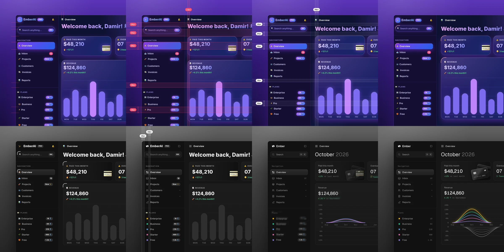

# unslop

Damir Sokolovsky([@heydamir](https://x.com/heydamir))가 만들었다. X에서 [Unslopping 시리즈](https://x.com/heydamir/status/2115063463063998736)를 시작한 사람이다.



unslop은 바이브 코딩으로 만든 AI 티 나는 UI를 자기 성격이 있는 디자인된 인터페이스로 바꾸는 Claude Code, Codex, Google Antigravity용 스킬이다. 먼저 슬롭을 찾는다. 보라색 그라디언트, 글로우, 이모지 라벨, 소리치는 카피, 들쭉날쭉한 간격이 그것이다. 그다음 제품에서 방향을 잡고, 디자이너가 레드라인 리뷰를 하듯 패스를 하나씩 돌려 화면을 고친다. Next.js, React, Vue, Svelte, Tailwind, 순수 HTML과 CSS 등 화면을 무엇으로 만들었든 동작한다. 대시보드, 앱, 랜딩 페이지에 쓸 수 있고, 링크밖에 없는 라이브 사이트에도 쓸 수 있다.

## 설치

Claude Code에서는 플러그인으로 설치한다. 모든 프로젝트에서 쓰려면 터미널에서 이렇게 실행한다.

```bash
claude plugin install unslop --marketplace heydamir/unslop
```

`--marketplace`가 없는 예전 Claude Code에서는 같은 작업을 두 단계로 나눠 실행한다.

```bash
claude plugin marketplace add heydamir/unslop
claude plugin install unslop@heydamir
```

프로젝트 하나에만 쓰려면 Claude Code를 시작하는 그 프로젝트의 루트 폴더에서 설치를 실행하고 `--scope local`을 붙인다. 프로젝트에서 일하는 모두에게 켜려면 대신 `--scope project`를 붙이고 `.claude/settings.json`을 커밋한다. 그러면 팀원은 각자 프로젝트 사본에서 이 명령을 한 번 실행한다.

```bash
claude plugin marketplace add heydamir/unslop
claude plugin install unslop@heydamir --scope project
```

그다음 Claude Code 세션을 새로 시작하거나 이미 열려 있는 세션에서 `/reload-plugins`를 실행한다.

업데이트하려면 `claude plugin update unslop@heydamir`를 실행하거나 `/plugin`의 Marketplaces에서 heydamir 마켓플레이스의 자동 업데이트를 켠다.

예전에 unslop을 `~/.claude/skills/`나 프로젝트의 `.claude/skills/`에 복사했다면 그 사본을 지운다. 지우지 않으면 `/unslop`이 플러그인 대신 그 사본을 계속 실행한다.

Codex에서는 이 저장소에서 스킬을 바로 설치하라고 요청한다.

```
$skill-installer install https://github.com/heydamir/unslop/tree/main/skills/unslop
```

또는 `~/.agents/skills/`나 프로젝트 안의 `.agents/skills/`에 직접 복사한다.

```bash
git clone https://github.com/heydamir/unslop
mkdir -p ~/.agents/skills && cp -r unslop/skills/unslop ~/.agents/skills/
```

Google Antigravity에서는 스킬을 skills 폴더에 복사한다.

```bash
git clone https://github.com/heydamir/unslop
mkdir -p ~/.gemini/config/skills && cp -r unslop/skills/unslop ~/.gemini/config/skills/
```

프로젝트 하나에만 쓰려면 그 프로젝트의 `.agents/skills/`에 복사한다.

라이브 사이트를 스냅샷하거나 스토리 영상을 만들려면 스킬을 돌리는 프로젝트 디렉터리에서 Playwright와 Chromium 브라우저를 설치한다.

```bash
npm install -D playwright
npx playwright install chromium
```

스토리 영상에는 ffmpeg도 필요하고 PATH에서 찾을 수 있어야 한다.

## 사용법

Claude Code에서는 `/unslop` 뒤에 원하는 것을 입력한다. 다른 스킬이 이미 그 이름을 쓰고 있으면 `/unslop:unslop`을 입력한다. Codex에서는 같은 방식으로 `$unslop`을 입력한다. 말로 요청해도 에이전트가 스킬을 알아서 고른다.

```
/unslop 이 대시보드
/unslop https://example.com 히어로
/unslop 내 랜딩 페이지, 올릴 수 있게 스토리 영상도 만들어 줘
```

무엇이든 고치기 전에 화면을 점검하고 방향을 제안하니 초반에 방향을 틀 수 있다. 화면이 이미 좋으면 그렇다고 말하고, 다시 디자인하는 대신 작은 다듬기를 몇 가지 제안한다.

## 하는 일

- **점검(Audit).** 슬롭의 징후를 위치와 함께 모두 나열한다.
- **방향(Direction).** 성격, 세계, 색을 담을 순간 한두 곳, 시그니처 디테일을 모두 제품에서 끌어낸다.
- **패스(Passes).** 간격, 색, 아이콘, 카피, 타입, 레이아웃, 디테일, 비주얼, 모션을 이 순서로 고친다.
- **비주얼(Visuals).** 번들거리는 블롭 대신 제품을 보여 준다. 히어로에 장면이나 오브젝트가 필요하면 fal, Replicate, OpenAI images, Higgsfield 같은 이미지 서비스로 생성할 수 있다. 연결된 서비스가 없으면 MCP 서버로 연결하자고 제안하고, 유료 생성 전에는 매번 프롬프트를 보여 주고 묻는다. 대시보드와 앱에는 거의 필요 없다.
- **스토리 영상(Story video).** 화면에서 슬롭이 걷히는 10초 미만의 정사각형 영상으로, 바로 올릴 수 있다. Playwright와 ffmpeg가 필요하다.

[examples](examples)의 바이브 코딩 화면 두 개로 시험해 본다.

## unslopper 고용하기

디자이너에게 맡기고 싶은가? Damir가 [heydamir.design/unslop](https://heydamir.design/unslop)에서 핵심 화면 하나를 3일 안에 사용 중인 스택으로 unslop해 준다.

## 라이선스

[CC BY 4.0](LICENSE). Damir Sokolovsky([@heydamir](https://x.com/heydamir))를 밝히고 원본 저장소로 링크를 걸면 상업적 사용을 포함해 쓰고, 바꾸고, 공유할 수 있다.

이 폴더는 [heydamir/unslop](https://github.com/heydamir/unslop)을 한국어로 번역한 것이다. 마크다운 문서와 `agents/openai.yaml`의 설명을 옮겼고 스크립트, 예제, 이미지는 원문 그대로다.
